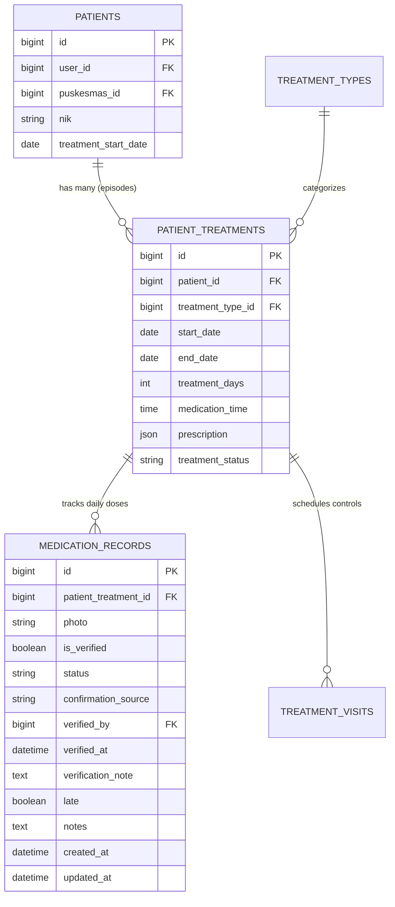

# AUDIT EPISODE PENGOBATAN DAN RIWAYAT OBAT (TB CARE)

## 1. Relasi Database

Arsitektur database TB Care memodelkan siklus pengobatan pasien melalui relasi bertingkat (*one-to-many*):



---

## 2. Masalah Multi-Episode Pengobatan

Seorang pasien tuberkulosis dapat menjalani lebih dari satu episode pengobatan dalam rentang waktu yang berbeda, misalnya:
- **Episode 1**: Kategori 1 (Pasien Baru) — Status: Selesai / Kambuh / Putus Obat.
- **Episode 2**: Kategori 2 (Pengobatan Ulang / Relapse) — Status: Berjalan.

### Potensi Cacat Logika (*Bug* Sebelum Audit):
Jika query riwayat minum obat mengambil data hanya berbasis `patient_id` (misalnya: `MedicationRecord::whereHas('patientTreatment', fn($q) => $q->where('patient_id', $patientId))`), maka seluruh catatan minum obat dari Episode 1 (pengobatan lama) akan tercampur dengan Episode 2 (pengobatan aktif). Akibatnya:
1. Statistik kepatuhan (*adherence percentage*) menjadi bias dan tidak valid.
2. Dosis minum obat masa lalu muncul pada pengobatan yang baru saja dimulai.
3. Pasien atau kader tidak dapat melihat evaluasi kepatuhan spesifik untuk episode pengobatan saat ini.

---

## 3. Solusi dan Isolasi Data Berbasis `patient_treatment_id`

### A. Endpoint API Laravel Scoping
Endpoint: `GET /api/treatments/{patientId}/history`

Logika penentuan target episode pengobatan:
```php
// Jika parameter treatment_id atau patient_treatment_id diberikan:
$patientTreatmentId = $request->query('treatment_id') ?? $request->query('patient_treatment_id');

if ($patientTreatmentId) {
    $targetTreatment = PatientTreatment::where('patient_id', $patientId)
        ->where('id', $patientTreatmentId)
        ->first();
} else {
    // Default: Ambil episode pengobatan aktif (Berjalan) terbaru
    $targetTreatment = PatientTreatment::where('patient_id', $patientId)
        ->where('treatment_status', 'Berjalan')
        ->latest('start_date')
        ->first()
        ?? PatientTreatment::where('patient_id', $patientId)->latest('id')->first();
}

// Query HANYA dibatasi pada patient_treatment_id milik episode tersebut:
$records = MedicationRecord::where('patient_treatment_id', $targetTreatment->id)
    ->orderBy('created_at', 'desc')
    ->get();
```

Respons API menyertakan kunci `treatment_id: <id>` secara eksplisit sehingga aplikasi mobile dapat memverifikasi episode mana yang sedang dilihat.

### B. Integrasi Flutter Mobile
- Pada widget `TreatmentPage` (`tb-care-mobile/lib/main/pasien/treatment.dart`):
  Mengirimkan `patientTreatmentId: _currentTreatment?['id']` ke `MedicationHistoryPage`.
- Pada `MedicationHistoryPage` (`tb-care-mobile/lib/main/pasien/history.dart`):
  Menyertakan parameter query string `&treatment_id=${widget.patientTreatmentId}` pada request HTTP.
- Pada `TreatmentHistoryPage` (`tb-care-mobile/lib/main/pasien/treatment_history.dart`):
  Setiap episode pengobatan yang pernah dijalani pasien dirender dalam card terpisah dengan statusnya masing-masing (`Berjalan`, `Selesai`, `Putus Obat`), dan menampilkan resep obat khusus episode tersebut.

---

## 4. Hasil Verifikasi dan Pengujian

Pengujian dilakukan melalui test case `test_medication_history_strictly_scoped_by_treatment_id`:
1. Pasien disiapkan dengan **Episode 1** (2 record minum obat) dan **Episode 2** (1 record minum obat).
2. Meminta history dengan `?treatment_id=episode1` -> Menghasilkan **tepat 2 record** (record Episode 2 tidak muncul).
3. Meminta history dengan `?treatment_id=episode2` -> Menghasilkan **tepat 1 record** (record Episode 1 tidak muncul).
4. Meminta history tanpa query param -> Default ke Episode 2 aktif.

Seluruh pengujian lolos tanpa kesalahan (PASS).
