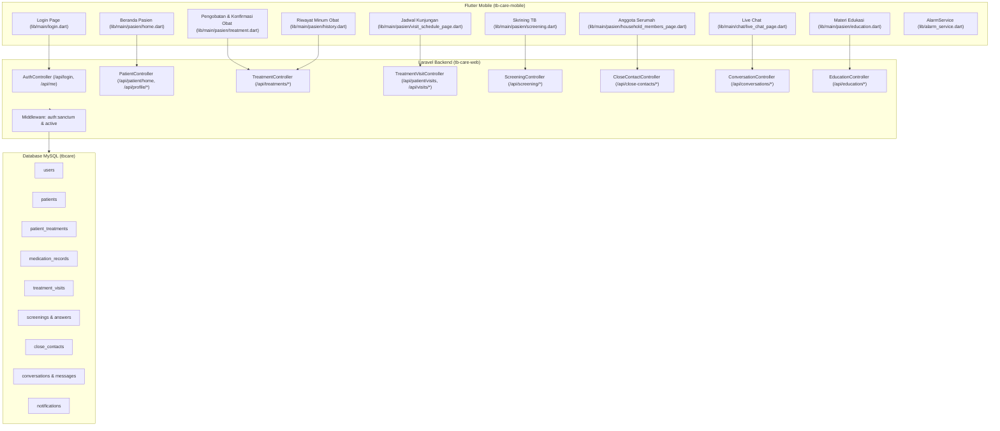

# AUDIT DAN PEMAHAMAN ARSITEKTUR ROLE PASIEN (PATIENT) APLIKASI TB CARE

## 1. PENDAHULUAN & TUJUAN AUDIT

Aplikasi TB Care merupakan sistem informasi manajemen pengobatan dan pemantauan pasien Tuberkulosis (TBC) berbasis mobile (Flutter) dan web (Laravel). Role Pasien (*Patient*) adalah salah satu peran inti dalam aplikasi, di mana pasien TBC menerima pendampingan minum obat, mengonfirmasi asupan obat harian beserta bukti visual, memantau jadwal kontrol/kunjungan ke fasilitas kesehatan, mengakses materi edukasi, serta melakukan skrining mandiri dan skrining kontak serumah (*close contact*).

Audit ini dilakukan secara mendalam pada arsitektur, kode sumber, skema basis data, lapisan keamanan/otorisasi (*Broken Access Control & IDOR*), konsistensi zona waktu, dan integrasi API antara **Flutter Mobile** (`tb-care-mobile`) dan **Laravel Backend** (`tb-care-web`).

---

## 2. ARSITEKTUR SISTEM ROLE PASIEN

---

## 3. IDENTIFIKASI STRUKTUR DATABASE DAN RELASI ROLE PASIEN

### 3.1. Entitas Pengguna & Pasien
- **`users`**:
  - Kolom kunci: `id`, `name`, `username`, `email`, `phone`, `password`, `user_type_id`, `photo`, `fcm_token`, `is_active`.
  - Pasien diidentifikasi secara baku dengan `user_type_id = 2`.
- **`patients`**:
  - Relasi: `belongsTo(User::class, 'user_id')`, `belongsTo(Puskesmas::class, 'puskesmas_id')`, `hasMany(PatientTreatment::class, 'patient_id')`, `hasMany(CloseContact::class, 'patient_id')`.
  - Kolom klinis: `id`, `user_id`, `nik`, `puskesmas_id`, `address`, `rt`, `rw`, `subdistrict_id`, `village_id`, `occupation`, `height`, `weight`, `blood_type`, `diagnosis_date`, `treatment_start_date`.

### 3.2. Entitas Pengobatan & Catatan Minum Obat
- **`patient_treatments`**:
  - Relasi: `belongsTo(Patient::class, 'patient_id')`, `belongsTo(TreatmentType::class, 'treatment_type_id')`, `hasMany(MedicationRecord::class, 'patient_treatment_id')`, `hasMany(TreatmentVisit::class, 'patient_treatment_id')`.
  - Kolom: `id`, `patient_id`, `treatment_type_id`, `diagnosis_date`, `start_date`, `end_date`, `treatment_days`, `medication_time`, `prescription`, `treatment_status`.
  - Status yang valid: `Berjalan`, `Selesai`, `Sembuh`, `Pengobatan Lengkap`, `Gagal`, `Meninggal`, `Putus Berobat`, `Tidak Dievaluasi`, `Pindah`.
- **`medication_records`**:
  - Relasi: `belongsTo(PatientTreatment::class, 'patient_treatment_id')`, `belongsTo(User::class, 'verified_by')`.
  - Kolom: `id`, `patient_treatment_id`, `photo`, `is_verified`, `status`, `confirmation_source`, `verified_by`, `verified_at`, `verification_note`, `late`, `notes`, `created_at`, `updated_at`.

### 3.3. Entitas Kunjungan & Skrining
- **`treatment_visits`**:
  - Relasi: `belongsTo(PatientTreatment::class, 'patient_treatment_id')`.
  - Kolom: `id`, `patient_treatment_id`, `visit_date`, `visit_time`, `visit_status`, `notes`.
  - Status valid: `Terjadwal`, `Selesai`, `Hadir`, `Tidak Hadir`, `Dibatalkan`.
- **`screenings` & `screening_answers`**:
  - Menyimpan rekam skrining mandiri pasien maupun skrining anggota kontak serumah (`close_contacts`).

---

## 4. TEMUAN AUDIT KEAMANAN DAN KELEMAHAN SISTEM (SEBELUM PERBAIKAN)

### 4.1. Celah Otorisasi / Broken Access Control (Kritis)
1. **Manipulasi Pengobatan Klinis oleh Pasien**:
   - Pada `TreatmentController::store()`, `destroy()`, dan `updateTreatmentStatus()`, controller hanya mengecek `if ($user->isKader())`. Karena pasien mengakses record-nya sendiri, pemeriksaan kepemilikan wilayah `$patient->isAccessibleBy($user)` mengembalikan nilai `true`. Akibatnya, pasien dapat mengubah jenis obat, tanggal diagnosis, atau menghapus riwayat pengobatan via API.
2. **Manipulasi Jadwal Kunjungan Klinis**:
   - Pada `TreatmentVisitController::store()`, `destroy()`, dan `cancelVisit()`, hanya Kader yang diblokir, sehingga Pasien dapat membuat, mengubah, atau membatalkan jadwal kunjungan medis yang seharusnya diatur petugas puskesmas.
3. **Penghapusan Master Data Pasien Sendiri**:
   - Pada `PatientController::destroy()`, hanya Kader yang diblokir, sehingga pasien dapat memanggil endpoint `DELETE /api/patients/{id}` untuk menghapus data rekam medis dan akunnya sendiri.
4. **Self-Verification Bukti Minum Obat**:
   - Pada `TreatmentController::verifyMedicationProof()`, pasien tidak diblokir sehingga pasien yang mengetahui endpoint dapat memverifikasi bukti minum obatnya sendiri tanpa evaluasi petugas kesehatan.

### 4.2. Logika Alur Bisnis Konfirmasi Minum Obat
- Pada `TreatmentController::submitMedicationProof()`, nilai `'is_verified' => true` diisi secara *hardcoded* saat pasien mengunggah foto. Hal ini menyebabkan status verifikasi langsung "Terverifikasi" dan melewati mekanisme telaah oleh PJTB/Petugas Puskesmas. Seharusnya status awal adalah `'is_verified' => false`, status `'Diminum'`, dan sumber konfirmasi `'patient'`.

### 4.3. Bug Paginasi & Infinite Scroll Duplication pada Riwayat Obat
- `MedicationHistoryPage` di Flutter mengirim parameter `page`, `per_page`, dan `filter`. Namun, `TreatmentController::medicationHistory()` mengabaikan parameter tersebut dan mengembalikan seluruh array riwayat pengobatan setiap saat. Akibatnya, saat pengguna scroll ke bawah, record yang sama di-*append* berulang kali ke dalam list UI secara terus-menerus.

### 4.4. Pemblokiran Foto oleh Cloudflare (HTTP 403 Forbidden)
- Pada `PatientController::home()`, URL foto profil dan foto bukti obat dikembalikan menggunakan helper `asset('images/' . $filename)`. Pada domain produksi, permintaan langsung ke folder fisik web root diblokir oleh Web Application Firewall (WAF) Cloudflare dengan kode status 403. URL yang benar harus melalui endpoint controller yang aman: `url('/api/image/' . $filename)`.

### 4.5. Inkonsistensi Zona Waktu (Timezone)
- Tanggal komputasi pada `PatientController::home()` sebagian menggunakan `Carbon::today()` (mengikuti UTC server), sementara pencatatan obat menggunakan `Carbon::today('Asia/Jakarta')`. Pada rentang waktu pukul 00:00 - 06:59 WIB, terjadi ketidaksesuaian penentuan status minum obat hari ini.

### 4.6. Navigasi Notifikasi yang Salah Sasaran di Flutter
- Pada `NotificationListPage` (`lib/main/notifications/notification_list_page.dart`), ketukan pada notifikasi dengan parameter `patient_id` selalu membuka `KaderPatientDetailPage`. Jika yang menekan adalah pengguna Role Pasien, aplikasi membuka halaman kader dan memunculkan error otorisasi 403.

### 4.7. Pengingat Minum Obat Tetap Aktif Pasca Pengobatan Selesai
- Pada `AlarmService.handleTreatment()`, pengecekan penghentian alarm hanya berlaku untuk status `'Selesai'`. Status akhir pengobatan klinis lainnya seperti `'Sembuh'`, `'Pengobatan Lengkap'`, `'Gagal'`, `'Putus Berobat'`, dll. tidak menghentikan alarm lokal sehingga alarm pasien tetap berdering.

---

## 5. KESIMPULAN AUDIT

Role Pasien memiliki cakupan fungsionalitas yang sangat penting dalam keberhasilan terapi TB (kepatuhan minum obat harian DOTS). Perbaikan menyeluruh telah dilakukan langsung pada kode sumber backend dan mobile untuk menutup celah otorisasi, memperbaiki alur verifikasi klinis, menghentikan duplikasi pagination, serta menyinkronkan pengingat lokal dan navigasi.
