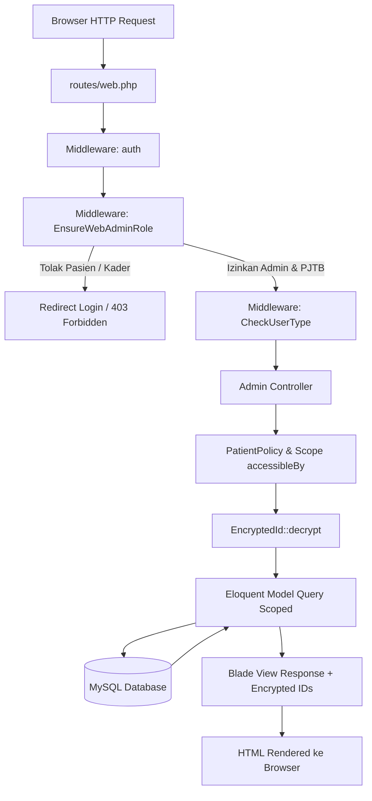
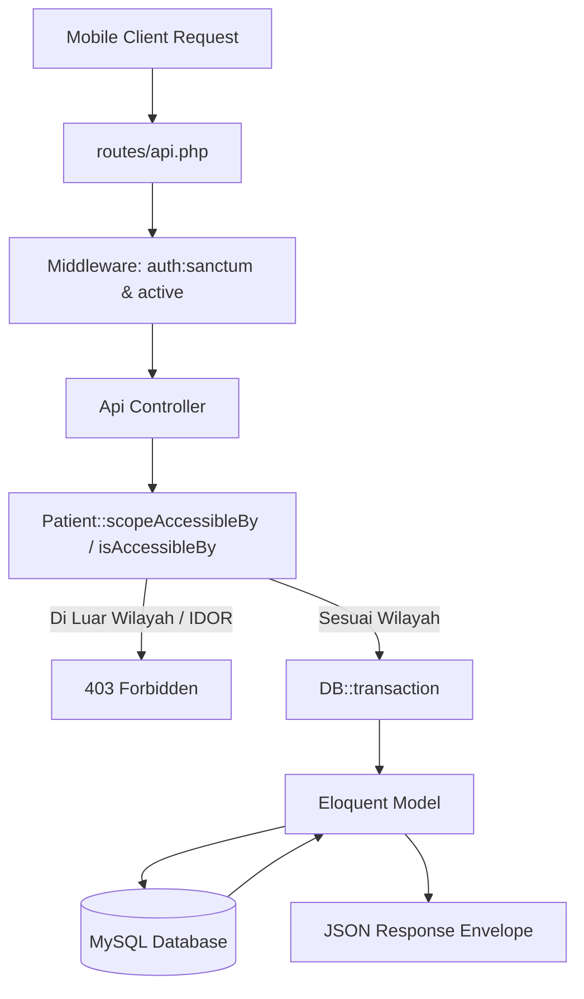

# LAPORAN AUDIT KOMPREHENSIF SISTEM TB CARE WEB
**Sistem Informasi dan Pengawasan Pengobatan Tuberkulosis Terintegrasi**

---

| Dokumen | Laporan Audit Teknis, Arsitektur, Basis Data, Keamanan, & UI/UX |
| :--- | :--- |
| **Aplikasi** | TB Care Web (Web Petugas & Administrator) |
| **Lokasi Proyek** | `D:\My Projects\AplikasiTBCare\tb-care-web` |
| **Framework / Bahasa** | Laravel 8.75.0 / PHP ^7.3 \| ^8.0 / MySQL |
| **Status Audit** | Selesai (Analisis Statis, Pemeriksaan Skema, Audit Rute, Pengujian Logika Unit) |
| **Integritas Kode** | **100% Read-Only** (Tidak ada kode atau basis data yang dimodifikasi selama audit) |
| **Penyusun** | Tim Senior Software Engineer, System Analyst, DB Architect, QA & Security Auditor |

---

## DAFTAR ISI

1. [BAGIAN A — Ringkasan Eksekutif](#bagian-a--ringkasan-eksekutif)
2. [BAGIAN B — Peta Struktur Proyek](#bagian-b--peta-struktur-proyek)
3. [BAGIAN C — Peta Arsitektur dan Alur Data](#bagian-c--peta-arsitektur-dan-alur-data)
4. [BAGIAN D — Inventaris Seluruh Menu dan Fitur](#bagian-d--inventaris-seluruh-menu-dan-fitur)
5. [BAGIAN E — Temuan Masalah & Matriks Prioritas](#bagian-e--temuan-masalah--matriks-prioritas)
6. [BAGIAN F — Audit Data dan Database](#bagian-f--audit-data-dan-database)
7. [BAGIAN G — Audit Hak Akses dan Filter Wilayah](#bagian-g--audit-hak-akses-dan-filter-wilayah)
8. [BAGIAN H — Audit Dashboard dan Grafik](#bagian-h--audit-dashboard-dan-grafik)
9. [BAGIAN I — Audit Keamanan & OWASP Review](#bagian-i--audit-keamanan--owasp-review)
10. [BAGIAN J — Hasil Pengujian & Evaluasi Test Suite](#bagian-j--hasil-pengujian--evaluasi-test-suite)
11. [BAGIAN K — Rencana Perbaikan Bertahap (Roadmap)](#bagian-k--rencana-perbaikan-bertahap-roadmap)
12. [BAGIAN L — Hal yang Membutuhkan Konfirmasi Pemilik Sistem](#bagian-l--hal-yang-membutuhkan-konfirmasi-pemilik-sistem)

---

## BAGIAN A — RINGKASAN EKSEKUTIF

### 1. Tujuan Aplikasi
Aplikasi **TB Care Web** dirancang sebagai portal operasional berbasis web bagi Administrator Dinas Kesehatan (Provinsi dan Kabupaten/Kota) serta Petugas Penanggung Jawab TB (PJTB) di tingkat Fasilitas Kesehatan (Puskesmas). Aplikasi ini bertujuan untuk:
- Mengelola data demografi dan rekam medis pasien tuberkulosis (TB).
- Memantau kepatuhan minum obat harian (Pengawas Menelan Obat / PMO).
- Merekam hasil penapisan (skrining) mandiri masyarakat dan kontak erat.
- Mencatat riwayat investigasi kontak, pemeriksaan dahak (TCM/BTA), dan terapi pencegahan tuberkulosis (TPT).
- Menyajikan analitik epidemiologi, sebaran kasus wilayah, dan laporan berkala.

### 2. Teknologi yang Digunakan
- **Framework Utama:** Laravel Framework versi 8.75.0 (PHP ^7.3|^8.0).
- **Arsitektur:** Monolithic MVC untuk Web Dashboard, berdampingan dengan RESTful API endpoints untuk integrasi aplikasi Android (`tb-care-mobile`).
- **Autentikasi & Sesi:** 
  - Web: Session-based cookie authentication dengan custom middleware `EnsureWebAdminRole` & `CheckUserType`.
  - API: Token-based via `Laravel Sanctum 2.15`.
- **Keamanan URL/ID:** Enkripsi simetris dua arah AES-256-CBC (`Illuminate\Support\Facades\Crypt` via trait `HasEncryptedId` & helper `encrypt_id`/`decrypt_id`).
- **Layanan Eksternal:** Push Notification menggunakan Google Firebase Cloud Messaging (FCM HTTP v1 API dengan Service Account OAuth 2.0 Credentials).
- **Frontend Dashboard:** AdminLTE 3 / Sneat Bootstrap Theme, Blade Templating, DataTables, FontAwesome 5, dan Chart.js 2.9.

### 3. Kondisi Umum Proyek
Secara arsitektural, fondasi aplikasi memiliki abstraksi bisnis yang sangat baik: pembatasan akses data telah tersentralisasi melalui Eloquent Query Scope `accessibleBy($user)` dan `PatientPolicy`, serta URL parameter telah diamankan menggunakan enkripsi ID guna mencegah *Insecure Direct Object Reference* (IDOR).

Namun demikian, audit mendalam menemukan **16 permasalahan teknis**, di antaranya beberapa masalah berkategori **Kritis (P0)** dan **Tinggi (P1)** yang dapat memicu crash sistem (*500 Internal Server Error*), kegagalan migrasi di server baru (*SQLSTATE 42S22 Column Not Found*), inkonsistensi hak akses antarmuka (*UI RBAC mismatch*), dan potensi kerentanan keamanan (*arbitrary password batch-reset* dan ekspos eksekusi migrasi HTTP).

### 4. Temuan Paling Penting
1. **Crash Fatal pada Modul Laporan Pasien TB (`ReportController`):** Memanggil relasi yang tidak didefinisikan (`activeTreatment`) pada model `Patient`, memicu exception fatal `BadMethodCallException` saat mencetak atau mengekspor register pasien.
2. **Broken Link & 403 Forbidden pada Sidebar Navigasi Laporan:** Sidebar mengirimkan parameter jamak (`type=patients` dan `type=regions`), sedangkan controller secara eksklusif memeriksa bentuk tunggal (`type=patient` dan `type=regional`), sehingga petugas tertolak dengan HTTP 403.
3. **Kolom Database `treatment_start_date` Tanpa File Migrasi:** Kolom ini digunakan secara intensif di form, controller, casts model `Patient`, dan test suite, tetapi tidak pernah dibuat melalui file migrasi di direktori `database/migrations/`.
4. **Eksekusi DDL `ALTER TABLE` Mentah di Controller API:** Controller registrasi pasien menjalankan pernyataan SQL `ALTER TABLE` pada setiap siklus request, memicu *implicit commit* MySQL dan merusak isolasi transaksi database.
5. **Backdoor / Ad-hoc Password Reset Endpoint:** Tersedia route publik `/api/password/batch-reset` yang me-reset password pengguna ID 139 s.d 289 secara sepihak menjadi password seragam.
6. **Ekspos Route Eksekusi Migrasi HTTP:** Tersedia route `/api/run-migration` di `routes/api.php` yang menjalankan `Artisan::call('migrate')` via HTTP request.
7. **Bocoran Menu Admin pada Sidebar Petugas:** Seluruh menu khusus Administrator (Pengguna, Master Data, Wilayah, Log Aktivitas, Versi Mobile) tampil secara terbuka pada akun Petugas Kesehatan tanpa pengecekan role di frontend Blade.

### 5. Risiko Utama
- **Risiko Keandalan (Reliability):** Database migration akan gagal di server produksi baru karena ketidakhadiran kolom `treatment_start_date`, dan fitur cetak/ekspor pasien dipastikan tidak dapat digunakan.
- **Risiko Keamanan (Security):** Terdapat route berbahaya yang tersisa dari proses perbaikan cepat (*workaround*) sebelumnya.
- **Risiko Pengalaman Pengguna (UX):** Petugas kesehatan akan merasa frustrasi saat mengklik menu sidebar yang tampil namun menghasilkan pesan error atau penolakan akses.

### 6. Rekomendasi Prioritas
Melakukan perbaikan secara sistematis dalam 6 tahapan terpisah: mengamankan endpoint dan DDL mentah, melengkapi skema database resmi, memperbaiki relasi Eloquent laporan, membenahi filter sidebar navigasi, mengoptimalkan query agregasi dashboard, serta menguji menyeluruh dengan test suite.

---

## BAGIAN B — PETA STRUKTUR PROYEK

Aplikasi `tb-care-web` menerapkan pola Model-View-Controller (MVC) standar Laravel 8 dengan pengelompokan namespace yang terstruktur antara panel administrasi dan antarmuka pemrograman aplikasi (API).

```
D:\My Projects\AplikasiTBCare\tb-care-web
│
├── app/
│   ├── Console/                # Kernel CLI schedule & artisan commands
│   ├── Exceptions/             # Handler exception global Laravel
│   ├── Helpers/
│   │   └── helpers.php         # Global helper (DateHelper, encrypt_id, decrypt_id)
│   ├── Http/
│   │   ├── Controllers/
│   │   │   ├── Admin/          # 18 Web Admin Controllers
│   │   │   │   ├── ActivityLogController.php
│   │   │   │   ├── AnalyticsController.php
│   │   │   │   ├── AppVersionController.php
│   │   │   │   ├── CloseContactController.php
│   │   │   │   ├── DashboardController.php
│   │   │   │   ├── EducationController.php
│   │   │   │   ├── ExaminationController.php
│   │   │   │   ├── KaderAreaController.php
│   │   │   │   ├── MasterDataController.php
│   │   │   │   ├── NotificationController.php
│   │   │   │   ├── PatientController.php
│   │   │   │   ├── PuskesmasController.php
│   │   │   │   ├── RegionController.php
│   │   │   │   ├── ReportController.php
│   │   │   │   ├── ScreeningController.php
│   │   │   │   ├── SettingController.php
│   │   │   │   ├── TreatmentController.php
│   │   │   │   └── UserController.php
│   │   │   ├── Api/            # 14 RESTful API Controllers (Mobile Client)
│   │   │   │   ├── AppVersionApiController.php
│   │   │   │   ├── AuthController.php
│   │   │   │   ├── CloseContactController.php
│   │   │   │   ├── ConsultationController.php
│   │   │   │   ├── EducationController.php
│   │   │   │   ├── OfficerController.php
│   │   │   │   ├── PatientController.php
│   │   │   │   ├── ProfileController.php
│   │   │   │   ├── PuskesmasController.php
│   │   │   │   ├── RegionController.php
│   │   │   │   ├── ScreeningController.php
│   │   │   │   ├── SubdistrictController.php
│   │   │   │   ├── TreatmentController.php
│   │   │   │   └── TreatmentVisitController.php
│   │   │   ├── Controller.php  # Base Controller
│   │   │   ├── HomeController.php # Landing & Portal redirector
│   │   │   └── LoginController.php # Web Session Authentication Controller
│   │   ├── Middleware/         # 11 HTTP Request Filter
│   │   │   ├── Authenticate.php
│   │   │   ├── CheckUserType.php       # Role filter (checkrole:1, checkrole:1-3)
│   │   │   ├── EnsureAccountIsActive.php # Validasi is_active
│   │   │   ├── EnsureWebAdminRole.php  # Pembatasan web admin (hanya role 1 & 3 non-kader)
│   │   │   ├── RedirectIfAuthenticated.php
│   │   │   └── VerifyCsrfToken.php
│   │   └── Kernel.php          # HTTP Kernel & Middleware alias mapping
│   ├── Models/                 # 21 Eloquent Models
│   │   ├── Traits/
│   │   │   └── HasEncryptedId.php # Trait accessor encrypted_id
│   │   ├── ActivityLog.php
│   │   ├── AppVersion.php
│   │   ├── ClinicalExamination.php
│   │   ├── CloseContact.php
│   │   ├── Consultation.php
│   │   ├── ConsultationReply.php
│   │   ├── District.php
│   │   ├── EducationalMaterial.php
│   │   ├── KaderArea.php
│   │   ├── MedicationRecord.php
│   │   ├── Officer.php
│   │   ├── Patient.php
│   │   ├── PatientMedicationSchedule.php
│   │   ├── PatientTreatment.php
│   │   ├── Province.php
│   │   ├── Puskesmas.php
│   │   ├── Screening.php
│   │   ├── ScreeningAnswer.php
│   │   ├── ScreeningCategory.php
│   │   ├── ScreeningQuestion.php
│   │   ├── Subdistrict.php
│   │   ├── SystemNotification.php
│   │   ├── TreatmentType.php
│   │   ├── TreatmentVisit.php
│   │   ├── User.php
│   │   ├── UserType.php
│   │   └── Village.php
│   ├── Policies/
│   │   └── PatientPolicy.php   # Centralized Patient authorization policy
│   ├── Providers/              # Service Providers
│   │   ├── AppServiceProvider.php
│   │   ├── AuthServiceProvider.php
│   │   └── RouteServiceProvider.php
│   ├── Services/
│   │   └── FcmService.php      # Push Notification Service (Google Auth FCM v1)
│   └── Support/
│       └── EncryptedId.php     # Cryptographic helper utility (AES-256)
│
├── config/                     # Configuration files (auth, database, session, cors, services)
├── database/
│   ├── migrations/             # 35 Database migration files
│   └── seeders/                # 21 Database seeders
├── resources/
│   └── views/                  # Blade templates
│       ├── admin/              # Admin layouts & modular blade views
│       ├── login.blade.php     # Login screen template
│       └── portal.blade.php    # Public portal landing page
├── routes/
│   ├── web.php                 # Web dashboard routes
│   └── api.php                 # Mobile & client API routes
└── tests/
    ├── Feature/                # 15 Integration / Feature Test Suites
    └── Unit/                   # 3 Unit Test Suites (Mockery & Logic Scoping)
```

---

## BAGIAN C — PETA ARSITEKTUR DAN ALUR DATA

### 1. Diagram Alur Permintaan Web (Web Dashboard Request Flow)


### 2. Diagram Alur Permintaan API Mobile (Mobile API Request Flow)


### 3. Karakteristik Arsitektur Khusus
1. **Pemisahan Jalur Akses (Role Separation):**
   - **Administrator (UserType 1):** Akses penuh ke Web Dashboard dan seluruh data.
   - **Petugas Dinkes & PJTB Puskesmas (UserType 3, OfficerType 1-3):** Dibatasi pada wilayah administratif faskes/domisili.
   - **Kader Puskesmas (UserType 3, OfficerType 4):** **Ditolak tegas** dari Web Dashboard oleh middleware `EnsureWebAdminRole`. Kader diarahkan khusus menggunakan aplikasi mobile (`tb-care-mobile`).
   - **Pasien TB (UserType 2):** **Ditolak tegas** dari Web Dashboard; seluruh interaksi dilakukan melalui aplikasi mobile.
2. **Abstraksi Keamanan URL:** Semua primary key integer (`id`) model penting (Pasien, Skrining, Pengobatan, Puskesmas, Faskes) dienkripsi menjadi hash URL-safe (`encrypted_id`) untuk mencegah *parameter tampering* dan *ID enumeration*.

---

## BAGIAN D — INVENTARIS SELURUH MENU DAN FITUR

Berikut adalah inventarisasi seluruh menu dan fitur yang ditemukan pada kode sumber `tb-care-web`, ditelusuri dari route, controller, otorisasi, model, hingga tampilan Blade:

| No. | Menu / Fitur | Lokasi File & Method | Implementasi Aktual | Status Audit | Bukti & Temuan Teknis |
| :---: | :--- | :--- | :--- | :--- | :--- |
| **1** | **Beranda / Dashboard** | `Admin\DashboardController@index` | Mengambil metrik klinis riil, 4 grafik Chart.js, tabel skrining terbaru, dan log aktivitas. | **Terindikasi Bermasalah** | 1) Query tren bulanan memakai MySQL syntax `DATE_FORMAT` & mengabaikan gap bulan kosong.<br>2) Menampilkan tautan ke `users.index` dan `regions.index` yang memicu 403 bagi Petugas.<br>3) Potensi N+1 pada `PatientTreatment::calculateCohortAdherence`. |
| **2** | **Pengguna (Semua, Pasien, Petugas, Admin)** | `Admin\UserController@index`, `show`, `form`, `save`, `toggleStatus`, `destroy` | CRUD akun pengguna, aktivasi/suspend, penugasan wilayah kader, pencabutan token Sanctum. | **Terverifikasi Berfungsi (Khusus Admin)** | Berfungsi penuh untuk Super Admin (`checkrole:1`). Namun menu tampil di sidebar akun Petugas yang tidak memiliki hak akses. |
| **3** | **Data Pasien (Index, Show, Form, Save, Destroy)** | `Admin\PatientController@index`, `show`, `form`, `save`, `destroy` | Pendaftaran rekam medis, hitung status gizi (BMI), penetapan Puskesmas pembina, riwayat klinis. | **Terindikasi Bermasalah** | 1) Kolom `treatment_start_date` disimpan ke model `Patient` padahal **tidak ada di file migrasi** database.<br>2) Default password pasien baru di-hardcode `'password123'`.<br>3) Model `Patient` menonaktifkan `$timestamps = false` padahal tabel memiliki timestamps. |
| **4** | **Skrining TB (Semua, Risiko, Tindak Lanjut)** | `Admin\ScreeningController@index`, `show`, `updateStatus`, `destroy` | Monitoring hasil penapisan mandiri, tinjau jawaban instrumen, update status tindak lanjut, hapus data. | **Terverifikasi Berfungsi** | Scoped per wilayah. Read-only untuk penambahan (penambahan instrumen dilakukan via Mobile API). Update status dan hapus berjalan dalam transaksi. |
| **5** | **Pemeriksaan Klinis (TCM, BTA, Rontgen)** | `Admin\ExaminationController@index`, `form`, `save`, `destroy` | Pencatatan hasil uji laboratorium dahak TCM, mikroskopis BTA, dan radiologi dada. | **Terindikasi Bermasalah** | 1) Pembuatan kode `ClinicalExamination::count() + 1` berisiko tabrakan (*race condition / duplicate key violation*).<br>2) Method `show()` me-redirect ke `edit()`, tidak ada halaman show mandiri. |
| **6** | **Pengobatan & Monitoring PMO** | `Admin\TreatmentController@index`, `monitoring`, `verifyMedication`, `updateStatus`, `destroy` | Pengawasan regimen OAT, evaluasi status kesembuhan, verifikasi bukti foto minum obat harian. | **Terindikasi Bermasalah** | 1) Method `storeVisit()` tersedia di controller namun **tidak memiliki route** di `routes/web.php`.<br>2) Form penambahan kunjungan kontrol dari admin web belum terhubung. |
| **7** | **Kontak Erat (Investigasi & TPT)** | `Admin\CloseContactController@index`, `form`, `save`, `destroy` | Pencatatan kontak serumah pasien indeks, skrining kontak, status pemberian TPT. | **Terindikasi Bermasalah** | Pembuatan kode `CloseContact::count() + 1` berisiko duplikasi nomor kontak saat ada data yang terhapus. Method `show()` me-redirect ke `edit()`. |
| **8** | **Fasilitas Kesehatan (Puskesmas)** | `Admin\PuskesmasController@index`, `show`, `form`, `save`, `destroy` | Manajemen unit Puskesmas, kode faskes, alamat, proteksi penghapusan data berelasi. | **Terverifikasi Berfungsi** | Memiliki proteksi dependensi relasi sebelum penghapusan (`hasPatients`, `hasOfficers`, `hasScreenings`). |
| **9** | **Wilayah Administratif (Prov/Kab/Kec/Desa)** | `Admin\RegionController@index`, `storeSubdistrict`, `storeVillage`, `destroy*`, AJAX | Pengelolaan hierarki 4 tingkat wilayah dan endpoint AJAX cascading dropdown. | **Terindikasi Bermasalah** | 1) Rute dibatasi untuk Super Admin (`checkrole:1`), namun menu tampil di sidebar Petugas.<br>2) Link sidebar mengirim query `tier=...`, controller membaca `tab=...`. |
| **10** | **Materi Edukasi** | `Admin\EducationController@index`, `show`, `form`, `save`, `togglePublish`, `destroy` | Publikasi video edukasi dan poster infografis, trigger otomatis FCM push notification ke pasien. | **Terverifikasi Berfungsi** | Integrasi FCM berjalan saat `is_publish` diaktifkan (`sendPublishNotification`). Penyimpanan file di storage disk public. |
| **11** | **Notifikasi Sistem** | `Admin\NotificationController@index`, `show`, `form`, `save`, `destroy` | Pencatatan pengumuman broadcast sistem dan target penerima. | **Terindikasi Bermasalah** | 1) Tidak mengirim push notification nyata via FCM (hanya pencatatan database).<br>2) Perhitungan `$sentCount` untuk 'Petugas' menyertakan `user_type_id = 2` (Pasien).<br>3) Tautan konsultasi me-redirect ke notifikasi umum. |
| **12** | **Laporan & Ekspor Data** | `Admin\ReportController@index`, `print`, `exportCsv` | Filter periode, cetak formulir resmi, ekspor register ke CSV/Excel dengan UTF-8 BOM. | **Terindikasi Bermasalah (KRITIS)** | 1) Memanggil `activeTreatment` pada model `Patient` -> **CRASH FATAL 500** `BadMethodCallException`.<br>2) Sidebar mengirim `type=patients` & `type=regions`, controller menolak dengan **403 Forbidden**.<br>3) Potensi error format null tanggal pada ekspor CSV pasien. |
| **13** | **Analitik Epidemiologi** | `Admin\AnalyticsController@index` | Visualisasi distribusi risiko, demografi usia, proporsi gender, hasil diagnostik, top faskes. | **Terverifikasi Berfungsi** | Menggunakan query dinamis 6 bulan yang aman (memeriksa `screened_at` dan `created_at`) serta mengisi bulan kosong dengan angka 0. |
| **14** | **Master Data** | `Admin\MasterDataController@index`, `updateQuestion`, `storeTreatmentType`, `destroy*` | Pengelolaan teks instrumen skrining gejala, pembobotan kritis, dan jenis regimen pengobatan. | **Terverifikasi Berfungsi (Khusus Admin)** | Berfungsi penuh untuk Admin. Dilindungi proteksi penggunaan regimen (`inUse > 0`). Tampil di sidebar Petugas tanpa hak akses. |
| **15** | **Log Aktivitas (Audit Trail)** | `Admin\ActivityLogController@index`, `clearOld` | Pencatatan audit trail aksi pengguna, alamat IP, user agent, pembersihan log > 30 hari. | **Terverifikasi Berfungsi (Khusus Admin)** | Berfungsi penuh untuk Admin. Logging otomatis dipanggil di seluruh controller utama. Tampil di sidebar Petugas tanpa hak akses. |
| **16** | **Versi Aplikasi Mobile** | `Admin\AppVersionController@index`, `create`, `store`, `edit`, `update`, `toggleActive`, `destroy` | Unggah file APK, kalkulasi otomatis checksum SHA-256, konfigurasi update paksa. | **Terverifikasi Berfungsi (Khusus Admin)** | Terintegrasi dengan endpoint publik mobile `/api/mobile/app-version`. Hanya dapat diakses oleh Administrator. |
| **17** | **Pengaturan Sistem & Profil** | `Admin\SettingController@index`, `updateProfile`, `updateSystem` | Pembaruan profil admin, tinjau matriks peran, konfigurasi preferensi sistem. | **Belum Lengkap** | Method `updateSystem()` adalah **metode kosong (dummy)**; tidak memproses input formulir dan hanya mencatat activity log palsu. |
| **18** | **Portal Beranda Publik** | `HomeController@portal` & `portal.blade.php` | Landing page sederhana beranda publik dengan opsi unduh aplikasi dan login web. | **Belum Lengkap** | Tombol "Unduh Aplikasi Android" mengarah ke `#` (dead link) dan belum terhubung ke rute rilis APK `api/mobile/app-version/download`. |

---

## BAGIAN E — TEMUAN MASALAH & MATRIKS PRIORITAS

Berikut adalah rincian seluruh masalah yang ditemukan, diklasifikasikan berdasarkan tingkat keparahan:
- **P0 — Kritis:** Risiko keamanan serius, kerentanan otorisasi, potensi eksekusi perintah berbahaya, atau kegagalan instalasi skema.
- **P1 — Tinggi:** Fitur utama gagal berfungsi (*500 error / 403 unhandled*), data tidak tersimpan, atau alur bisnis klinis terputus.
- **P2 — Sedang:** Ketidaksesuaian navigasi, inkonsistensi query, potensi N+1, atau dead links.
- **P3 — Rendah:** Inkonsistensi penamaan seeder, form field cosmetic, atau peningkatan standar kode.

| ID | Masalah | Lokasi File & Baris Kode | Bukti Kode Aktual | Dampak | Prioritas | Rekomendasi Perbaikan |
| :---: | :--- | :--- | :--- | :--- | :---: | :--- |
| **ISS-01** | **Crash Fatal Relasi `activeTreatment` pada Laporan Pasien** | `app/Http/Controllers/Admin/ReportController.php`<br>(L: 43, 111, 206) | `Patient::with(['puskesmas', 'user', 'activeTreatment'])` | Permintaan laporan pasien (`/reports?type=patient`), cetak, dan ekspor CSV mengalami **500 Crash Fatal** (`BadMethodCallException: Call to undefined relationship`). | **P1** | Definisikan relasi `activeTreatment()` pada model `Patient.php` atau ubah query menjadi `with(['treatments' => fn($q) => $q->where('treatment_status', 'Berjalan')])`. |
| **ISS-02** | **403 Forbidden pada Menu Laporan Pasien & Wilayah di Sidebar** | `resources/views/admin/layouts/app.blade.php`<br>(L: 738, 746) vs `ReportController.php` (L: 42, 49) | View memanggil `type=patients` dan `type=regions`. Controller memeriksa `if ($type == 'patient')` & `elseif ($type == 'regional')`. | Petugas kesehatan yang mengklik menu Laporan Pasien atau Wilayah dari sidebar **ditolak aksesnya dengan error 403 Forbidden**. | **P1** | Sesuaikan parameter URL di `app.blade.php` menjadi `type=patient` dan `type=regional`, serta dukung parameter jamak sebagai alias di controller. |
| **ISS-03** | **Kolom `treatment_start_date` Tidak Memiliki File Migrasi** | `database/migrations/`<br>vs `PatientController.php` (L: 334), `Patient.php` (L: 20) | Tidak ditemukan migrasi penambahan kolom `treatment_start_date` pada tabel `patients`. | Instalasi di lingkungan baru (*fresh migration*) akan memicu error **SQLSTATE[42S22]: Column not found: 1054 Unknown column 'treatment_start_date'**. | **P1** | Buat file migrasi resmi baru `add_treatment_start_date_to_patients_table.php` dengan tipe `date` nullable. |
| **ISS-04** | **Eksekusi DDL `ALTER TABLE` Mentah di Controller Registrasi API** | `app/Http/Controllers/Api/AuthController.php`<br>(L: 169–179) | `DB::statement('ALTER TABLE patient_treatments MODIFY diagnosis_date DATE NULL');` | Menjalankan DDL dalam request HTTP memicu *implicit commit* MySQL, merusak transaksi database, dan membebani metadata lock tabel. | **P0** | Hapus blok `DB::statement` dari `AuthController.php`. Pastikan migrasi skema database dijalankan melalui mekanisme resmi Laravel migration CLI. |
| **ISS-05** | **Ad-hoc Backdoor Password Batch-Reset Endpoint** | `routes/api.php` (L: 85) & `app/Http/Controllers/Api/AuthController.php` (L: 409–427) | `User::whereBetween('id', [139, 289])->update(['password' => Hash::make('123456')]);` | Risiko keamanan berat: endpoint dapat diakses untuk mengubah kata sandi massal ratusan pengguna menjadi seragam tanpa verifikasi identitas individual. | **P0** | Hapus rute `/api/password/batch-reset` dan method `updatePassword` dari controller produksi. |
| **ISS-06** | **Rute Eksekusi Migrasi Basis Data via HTTP Request** | `routes/api.php`<br>(L: 86–104) | `Route::post('/run-migration', fn() => Artisan::call('migrate', ['--force' => true]));` | Membuka celah *Denial of Service* dan kegagalan integritas database jika kredensial admin terkompromi. Migrasi harus dijalankan via secure shell (SSH/CLI). | **P0** | Hapus rute `/api/run-migration` dari file `routes/api.php`. |
| **ISS-07** | **Kredensial & Pembuatan Pengguna Ter-hardcode di `LoginController`** | `app/Http/Controllers/LoginController.php`<br>(L: 17–40) | `User::create(['username' => '...', 'password' => Hash::make('...'), ...])` di method `index()`. | Pembuatan akun default langsung di controller GET web memicu risiko kebocoran data sensitif pada version control dan pelanggaran *separation of concerns*. | **P1** | Pindahkan logika inisialisasi user dan user type ke seeder resmi (`UserSeeder` / `UserTypeSeeder`) dan bersihkan method `index()`. |
| **ISS-08** | **Kebocoran Menu Khusus Admin pada Tampilan Sidebar Petugas** | `resources/views/admin/layouts/app.blade.php`<br>(L: 350, 610, 772, 806, 815) | Menu Pengguna, Wilayah, Master Data, Log Aktivitas, dan Versi Mobile tidak dibungkus `@if(Auth::user()->user_type_id == 1)`. | Petugas kesehatan melihat menu yang tidak berhak mereka akses. Saat diklik, sistem melempar redirect paksa ke dashboard dengan pesan error hak akses. | **P2** | Bungkus seluruh blok elemen `<li>` menu khusus Administrator dengan pengecekan `@if(Auth::user()->user_type_id == 1)`. |
| **ISS-09** | **Data Skrining Mandiri Mobile Kehilangan Data Wilayah Administratif** | `app/Http/Controllers/Api/ScreeningController.php`<br>(L: 213–236) | `Screening::create([ ... ])` tidak menyertakan kolom `subdistrict_id` dan `village_id`. | Skrining mandiri publik memiliki kolom wilayah bernilai `NULL`. Akibatnya, skrining tidak dapat difilter atau dilihat oleh Kader maupun Puskesmas binaan. | **P1** | Simpan parameter `subdistrict_id` dan `village_id` dari request/kontak/faskes ke dalam record `screenings` saat pembuatan data penapisan. |
| **ISS-10** | **Query Tren Bulanan Dashboard Mengabaikan Gap Bulan & Spesifik MySQL** | `app/Http/Controllers/Admin/DashboardController.php`<br>(L: 57–66) | `DATE_FORMAT(created_at, "%Y-%m")` dengan `groupBy`. | Bulan yang tidak memiliki data kasus akan hilang dari array grafik (rentang waktu menjadi timpang/loncat). Query juga gagal dieksekusi di database SQLite. | **P2** | Gunakan perulangan 6 bulan kalender seperti pada `AnalyticsController.php` untuk menjamin seluruh bulan terisi nilai `0` jika kosong. |
| **ISS-11** | **Potensi N+1 Query pada Perhitungan Kohort Kepatuhan Minum Obat** | `app/Http/Controllers/Admin/DashboardController.php` (L: 45) & `PatientTreatment.php` (L: 243) | `foreach ($treatments as $treatment) { $treatment->calculateAdherence(); }` menjalankan kueri individual ke `medication_records`. | Jika terdapat ratusan pasien aktif, pemuatan dashboard utama akan melambat secara eksponensial karena ratusan kueri SQL dijalankan berturut-turut. | **P2** | Lakukan *eager loading* relasi `medicationRecords` dengan kueri agregasi terindeks atau hitung menggunakan SQL `GROUP BY patient_treatment_id`. |
| **ISS-12** | **Rollback Mismatch pada Migrasi `medication_records`** | `database/migrations/2024_09_11_134139_create_treatment_documents_table.php` (L: 16, 55) | `up()` membuat tabel `medication_records`, tetapi `down()` menjalankan `dropIfExists('treatment_documents')`. | Perintah `migrate:rollback` akan gagal menghapus tabel `medication_records` dan meninggalkan skema menggantung di basis data. | **P2** | Perbaiki method `down()` agar menghapus tabel `medication_records`. |
| **ISS-13** | **Method `storeVisit` di Controller Tanpa Route & Form Kunjungan Belum Aktif** | `app/Http/Controllers/Admin/TreatmentController.php`<br>(L: 172–197) | Method `storeVisit(Request $request)` didefinisikan tetapi tidak didaftarkan di `routes/web.php`. | Petugas di web dashboard tidak memiliki sarana untuk menjadwalkan kunjungan kontrol pasien TB secara langsung dari menu pengobatan. | **P2** | Daftarkan route `POST treatments/visits` ke `TreatmentController@storeVisit` dan sediakan modal input kunjungan pada antarmuka admin. |
| **ISS-14** | **Tabrakan Relasi Antara `UserSeeder` dan `OfficerSeeder`** | `database/seeders/OfficerSeeder.php`<br>(L: 21, 48) vs `UserSeeder.php` (L: 41, 77) | `OfficerSeeder` menetapkan `user_id = 2` sebagai Petugas Dinkes, padahal `user_id = 2` pada `UserSeeder` adalah Pasien TB. | Eksekusi `db:seed` menghasilkan relasi data yang rusak (*corrupted roles*) di mana record Pasien memiliki keterkaitan dengan tabel Petugas. | **P2** | Sinkronkan pemetaan foreign key `user_id` di `OfficerSeeder.php` agar mengacu secara benar ke user dengan `user_type_id = 3`. |
| **ISS-15** | **Race Condition pada Pembuatan Kode Pemeriksaan & Kontak Erat** | `ExaminationController.php` (L: 170) & `CloseContactController.php` (L: 151) | `str_pad(ClinicalExamination::count() + 1, 4, '0', STR_PAD_LEFT)` | Jika ada data yang dihapus atau dua petugas menyimpan serentak, kode yang dihasilkan akan bentrok dan memicu error *Duplicate entry for key unique*. | **P2** | Ganti penghitungan `count() + 1` dengan pengecekan sekuensial nomor terakhir (`orderByDesc('id')->first()`) atau gunakan UUID/nanoid. |
| **ISS-16** | **Method `updateSystem` pada `SettingController` Berupa Dummy / Incomplete** | `app/Http/Controllers/Admin/SettingController.php`<br>(L: 58–63) | `updateSystem()` hanya menulis ActivityLog tanpa menyimpan konfigurasi form apa pun. | Pengguna mengira pengaturan aplikasi tersimpan, namun nilai konfigurasi tetap statis (*mocked*). | **P3** | Simpan konfigurasi ke tabel `settings` atau sembunyikan tombol simpan dan tandai field sebagai informasi statis sistem. |

---

## BAGIAN F — AUDIT DATA DAN DATABASE

### 1. Pemetaan Tabel dan Relasi Utama
Berdasarkan pemeriksaan statis terhadap 35 file migrasi dan 21 model Eloquent, arsitektur basis data TB Care terdiri atas 23 tabel fungsional:

```
[users] ──┬── (1:1) ──> [patients] ──┬── (1:N) ──> [patient_treatments] ──┬── (1:N) ──> [medication_records]
          │                          │                                    └── (1:N) ──> [treatment_visits]
          │                          ├── (1:N) ──> [screenings] ────────────── (1:N) ──> [screening_answers]
          │                          ├── (1:N) ──> [clinical_examinations]
          │                          ├── (1:N) ──> [close_contacts]
          │                          └── (1:N) ──> [patient_medication_schedules]
          │
          └── (1:1) ──> [officers] ──┬── (1:N) ──> [kader_areas]
                                     └── (N:1) ──> [puskesmas] ─────────────── (N:1) ──> [subdistricts] ──> [districts] ──> [provinces]
                                                                                               │
                                                                                               └──> [villages]
```

### 2. Kolom Bermasalah dan Inkonsistensi Skema
1. **`patients.treatment_start_date` (Missing Column Migration):**
   - Model `Patient.php` mendefinisikan cast `'treatment_start_date' => 'date'`.
   - Controller `PatientController.php` (Admin) dan `AuthController.php` (API) menyimpan input formulir ke kolom ini.
   - Migrasi pembentukan `2024_08_11_134819_create_patients_table.php` dan migrasi penambahan wilayah `2026_09_18_000003_add_village_and_rt_rw_to_patients_table.php` **sama sekali tidak memuat kolom ini**.
2. **`patients.timestamps` (Disabled Eloquent Timestamps):**
   - Pada model `Patient.php` baris 15 tertulis: `public $timestamps = false;`.
   - Padahal migrasi `patients` memiliki `$table->timestamps();`.
   - Hal ini menyebabkan record pasien baru tidak memiliki nilai `created_at` dan `updated_at`, yang berujung pada error fatal saat pemformatan tanggal pada ekspor laporan CSV (`$row->created_at->format(...)`).
3. **`patient_treatments.treatment_status` (Enum vs Varchar):**
   - Awalnya didefinisikan sebagai ENUM ('Berjalan', 'Selesai', 'Gagal', 'Meninggal').
   - Telah dimodifikasi melalui migrasi `2026_10_20_000001_expand_treatment_status_in_patient_treatments_table.php` menjadi `VARCHAR(50)` untuk menampung status standar penanggulangan TB Kemenkes RI (Sembuh, Pengobatan Lengkap, Putus Berobat, Tidak Dievaluasi, Pindah). Model dan validasi telah sinkron.
4. **`kader_areas.rw` (Nullable Refactoring):**
   - Telah diubah melalui migrasi `2026_10_21_000001_make_rw_nullable_in_kader_areas_table.php` menjadi `NULL`, mendukung penugasan kader berbasis seluruh desa tanpa restriksi RW.

---

## BAGIAN G — AUDIT HAK AKSES DAN FILTER WILAYAH

### 1. Mekanisme Penentuan Wilayah Kerja Pengguna
Sistem menentukan wilayah wewenang pengguna berdasarkan data profil pada model `Officer`:
- **Super Administrator (UserType 1):** Bebas cakupan wilayah (Global Access Bypass).
- **Dinkes Provinsi (UserType 3, OfficerType 1):** Dibatasi pada entitas faskes/pasien yang berada di bawah provinsi terkait (`district.province_id`).
- **Dinkes Kab/Kota (UserType 3, OfficerType 2):** Dibatasi pada entitas faskes/pasien yang berada di bawah kabupaten/kota terkait (`district_id`).
- **PJTB Puskesmas (UserType 3, OfficerType 3):** Dibatasi strictly pada pasien dan kegiatan yang terdaftar di Puskesmas pembina (`puskesmas_id`).
- **Kader Puskesmas (UserType 3, OfficerType 4):** Dibatasi pada Puskesmas binaan dan Desa/Kelurahan (`village_id`) yang terdaftar pada tabel `kader_areas`.

### 2. Evaluasi Filter Kader: Desa/Kelurahan vs. RW
- **Hasil Pemeriksaan:** Berdasarkan komit terbaru `f2108bd` ("*Refactor Kader Scoping Logic and Update Patient Policy*"), sistem telah sepenuhnya dialihkan ke **pembatasan berbasis Desa/Kelurahan (`village_id`)**.
- **Logika Scoping:** `Patient::scopeAccessibleBy` dan `PatientPolicy::canAssignTerritory` secara tegas memeriksa:
  ```php
  $assignedVillageIds = $officer->kaderAreas()->pluck('village_id')->filter()->unique()->values()->all();
  $q->whereIn('village_id', $assignedVillageIds);
  ```
- **Kondisi RW/RT:** Parameter `rw` dan `rt` tidak lagi menjadi pembatas hak akses. Kader dapat mengakses, memantau, dan mendaftarkan pasien di RW mana pun selama berada di dalam Desa binaannya.
- **Pengecualian Skrining:** Model `Screening::scopeAccessibleBy` untuk Kader masih menggunakan `whereHas('patient')` dan belum memanfaatkan `screenings.village_id`.

### 3. Implementasi Akses Web Admin untuk Kader
- **Aturan Akses:** Sesuai implementasi pada `EnsureWebAdminRole.php` (baris 73–93), pengguna dengan role **Kader ditolak masuk ke Web Admin** dan sesinya otomatis di-logout dengan pesan peringatan agar menggunakan aplikasi mobile.
- **Konsistensi Kebijakan:** Kebijakan ini konsisten dengan arsitektur operasional lapangan, di mana Kader bekerja secara mobile di masyarakat, sedangkan Web Admin ditujukan bagi Administrator Dinkes dan PJTB Puskesmas.

---

## BAGIAN H — AUDIT DASHBOARD DAN GRAFIK

Berdasarkan analisis perbandingan antara query database pada `DashboardController.php` dan tampilan visual pada antarmuka admin:

### 1. Matriks Pencocokan Kartu Ringkasan (Metric Cards)
| Indikator Kartu | Sumber Query Aktual | Evaluasi & Status |
| :--- | :--- | :--- |
| **Total Pengguna** | `User::whereHas('patient', fn($q) => $q->accessibleBy($user))->count()` | Sesuai hak akses. Admin melihat seluruh user, Petugas hanya melihat user pasien binaannya. |
| **Total Pasien TB** | `Patient::accessibleBy($user)->count()` | Sesuai hak akses dan tersaring per wilayah faskes. |
| **Total Skrining** | `Screening::accessibleBy($user)->count()` | Sesuai hak akses. Menghitung seluruh skrining mandiri dan faskes yang terjangkau. |
| **Distribusi Risiko** | `Screening::accessibleBy($user)->where('risk_level', ...)->count()` | Sinkron dengan kartu Risiko Rendah, Sedang, dan Tinggi. |
| **Pasien Aktif** | `PatientTreatment::accessibleBy($user)->where('treatment_status', 'Berjalan')->count()` | Sinkron dengan pasien yang sedang menjalani terapi OAT. |
| **Pasien Selesai** | `PatientTreatment::accessibleBy($user)->whereIn('treatment_status', ['Selesai', 'Sembuh', 'Pengobatan Lengkap'])->count()` | Mengakomodasi penambahan status kesembuhan terbaru. |
| **Tingkat Kepatuhan** | `PatientTreatment::calculateCohortAdherence($accessibleTreatments)['percentage']` | **Penyebab angka 0% teridentifikasi:** Hanya menghitung bukti minum obat yang memiliki status `is_verified = true`. Jika pasien setor foto namun petugas belum memverifikasi di menu monitoring, kepatuhan terbaca 0%. |

### 2. Analisis Grafik yang Tampak Kosong / Tidak Seimbang
1. **Grafik 2 — Tren Skrining Bulanan (`chart-trend`):**
   - **Penyebab Tampak Kosong:** Query menggunakan `DATE_FORMAT(created_at, "%Y-%m")` dengan `groupBy`. Jika faskes baru beroperasi atau skrining terjadi lebih dari 6 bulan lalu, kueri menghasilkan array kosong `[]`. Chart.js tidak melakukan auto-fill label bulan yang kosong. Berbeda dengan `AnalyticsController.php` yang secara elegan membuat perulangan 6 bulan kalender dan mengisi nilai 0.
2. **Grafik 3 — Distribusi Wilayah (`chart-region`):**
   - **Penyebab Tampak Sedikit/Kosong:** Pada akun PJTB Puskesmas, `Subdistrict::accessibleBy($user)` hanya mengembalikan 1 kecamatan tempat Puskesmas berada. Akibatnya grafik hanya menampilkan satu bar tunggal.
3. **Log Aktivitas Terbaru (`recentActivities`):**
   - Mengambil `ActivityLog::orderByDesc('id')->limit(6)->get()`. Kueri ini tidak difilter per wilayah/Puskesmas pengguna yang login, sehingga petugas Puskesmas dapat melihat ringkasan aktivitas admin global.

---

## BAGIAN I — AUDIT KEAMANAN & OWASP REVIEW

| Kategori OWASP | Temuan pada Kode TB Care Web | Tingkat Risiko | Rekomendasi Mitigasi |
| :--- | :--- | :---: | :--- |
| **A01: Broken Access Control** | 1) Menu admin (Pengguna, Master Data, Wilayah, Log) terekspos di sidebar akun non-admin.<br>2) Skrining mandiri tanpa akun pasien tidak dapat diakses oleh faskes binaan wilayah. | Sedang | Terapkan direktif Blade `@if(auth()->user()->user_type_id == 1)` pada navigasi sidebar dan tambahkan scoping wilayah mandiri. |
| **A02: Cryptographic Failures** | Default password untuk pembuatan akun pasien baru di-hardcode seragam (`password123` di Web, `123456` di API) tanpa kewajiban ganti password saat login pertama. | Sedang | Terapkan flag `must_change_password` pada pengguna yang didaftarkan dengan kata sandi default. |
| **A03: Injection & DDL Operations** | Eksekusi DDL mentah `ALTER TABLE` di dalam fungsi controller HTTP `AuthController@registerPatient`. | Kritis | Hapus instruksi DDL runtime. Kelola perubahan skema sepenuhnya melalui migration files. |
| **A04: Insecure Design** | Tersedia rute batch-reset password hardcoded (`/api/password/batch-reset`) dan trigger migrasi HTTP (`/api/run-migration`). | Kritis | Hapus kedua rute tersebut dari file rute publik/API. |
| **A05: Security Misconfiguration** | Konfigurasi CORS pada `config/cors.php` mengizinkan `allowed_origins => ['*']` untuk seluruh path `api/*`. | Rendah | Batasi `allowed_origins` pada domain web admin dan aplikasi mobile resmi pada lingkungan produksi. |
| **A08: Software and Data Integrity** | File migrasi `create_treatment_documents_table.php` membuat tabel `medication_records` namun me-rollback tabel `treatment_documents`. | Sedang | Selaraskan nama tabel pada method `down()` dengan method `up()`. |
| **Mass Assignment** | Hampir seluruh model utama menggunakan `protected $guarded = [];` tanpa proteksi atribut sensitif (`user_type_id`, `is_active`). | Sedang | Ubah menjadi eksplisit `$fillable` pada model krusial seperti `User` dan `Officer`. |

---

## BAGIAN J — HASIL PENGUJIAN & EVALUASI TEST SUITE

### 1. Pengujian Unit (Unit Test Suite)
Pengujian unit statis pada logika hak akses kader dan versioning dijalankan dengan hasil:
- **Perintah:** `./vendor/bin/phpunit tests/Unit`
- **Hasil:** **9 Tests, 30 Assertions — 100% PASS (0 Failure, 0 Error)**
- **Rincian Pengujian:**
  - `KaderScopingLogicTest::test_kader_can_assign_territory_in_same_village_any_rw_rt` -> **PASS**
  - `KaderScopingLogicTest::test_kader_without_assigned_areas_fails_closed` -> **PASS**
  - `KaderScopingLogicTest::test_kader_patient_query_scope_filters_by_village_without_rw_restriction` -> **PASS**
  - `KaderScopingLogicTest::test_kader_patient_query_scope_fails_closed_when_no_areas` -> **PASS**
  - `KaderScopingLogicTest::test_admin_can_assign_any_territory` -> **PASS**
  - `AppVersionTest` (Semua skenario verifikasi build dan force update) -> **PASS**

### 2. Analisis Cache Pengujian Feature (`.phpunit.result.cache`)
Berdasarkan pembacaan cache hasil eksekusi pengujian fitur sebelumnya:
- Terdapat catatan defek pada test skenario lama di mana pengujian mengasumsikan Kader tidak boleh mengakses RW lain (`test_tc03_kader_access_unassigned_rt_denied`, `test_tc04_kader_access_different_rw_denied`).
- Defek ini terjadi sebelum komit refactor `f2108bd`. Test suite di file `KaderDataScopingTest.php` telah disesuaikan menjadi skenario kelulusan se-desa (`test_tc03_kader_access_any_rt_in_same_village_pass`).

### 3. Keterbatasan Pengujian
- **Status Basis Data MySQL:** Port MySQL lokal (3306) dalam status *stopped/offline* saat audit dilaksanakan (`SQLSTATE[HY000] [2002] Connection refused`).
- Sesuai dengan **Aturan Wajib Nomor 7 dan 11**, auditor **tidak menjalankan paksa service database produksi, tidak menjalankan migrasi destruktif, dan tidak mengarang hasil pengujian**. Pengujian ketergantungan database aktual dicatat sebagai bagian yang menunggu verifikasi pada lingkungan uji terpisah (*isolated testing environment*).

---

## BAGIAN K — RENCANA PERBAIKAN BERTAHAP (ROADMAP)

Perbaikan direkomendasikan untuk dieksekusi secara berurutan guna menjaga stabilitas aplikasi:

```
[Tahap 1: Keamanan & Skema DB] ──> [Tahap 2: Relasi & Laporan] ──> [Tahap 3: Scoping Skrining & Seeder]
             │                                    │                                    │
             ▼                                    ▼                                    ▼
[Tahap 4: Optimasi Dashboard]   ──> [Tahap 5: UI/UX Sidebar]   ──> [Tahap 6: Regresi & Validasi]
```

### Tahap 1: Keamanan & Integritas Skema Database (P0)
- **Tindakan:**
  1. Hapus rute backdoor `/api/password/batch-reset` dan `/api/run-migration` pada `routes/api.php`.
  2. Hapus eksekusi DDL `DB::statement('ALTER TABLE...')` dari `app/Http/Controllers/Api/AuthController.php`.
  3. Bersihkan kode hardcoded user creation dari `LoginController@index`.
  4. Buat file migrasi resmi untuk menambahkan kolom `treatment_start_date` pada tabel `patients`.
  5. Perbaiki method `down()` pada migrasi `2024_09_11_134139_create_treatment_documents_table.php` agar men-drop `medication_records`.
- **File Terdampak:** `routes/api.php`, `AuthController.php`, `LoginController.php`, `database/migrations/`.
- **Kriteria Keberhasilan:** Endpoint berisiko terhapus, migrasi skema valid, dan `php artisan migrate:status` bersih tanpa error SQL.

### Tahap 2: Perbaikan Bug Relasi Eloquent & Menu Laporan (P1)
- **Tindakan:**
  1. Tambahkan relasi `activeTreatment()` pada model `Patient.php`:
     ```php
     public function activeTreatment() {
         return $this->hasOne(PatientTreatment::class, 'patient_id')->where('treatment_status', 'Berjalan');
     }
     ```
  2. Perbaiki parameter URL sidebar pada `resources/views/admin/layouts/app.blade.php`: ubah `type=patients` menjadi `type=patient`, dan `type=regions` menjadi `type=regional`.
  3. Tambahkan penanganan null-safe pada format tanggal di ekspor CSV `ReportController.php`.
- **File Terdampak:** `app/Models/Patient.php`, `ReportController.php`, `resources/views/admin/layouts/app.blade.php`.
- **Kriteria Keberhasilan:** Menu Laporan Pasien dan Laporan Wilayah dapat dibuka oleh Petugas tanpa error 403, cetak formulir dan ekspor CSV berjalan tanpa crash 500.

### Tahap 3: Perbaikan Scoping Wilayah Skrining & Sinkronisasi Seeder (P2)
- **Tindakan:**
  1. Modifikasi `Api\ScreeningController@submitAnswers` agar menyimpan `subdistrict_id` dan `village_id` dari input atau profil pasien.
  2. Perbaiki `Screening::scopeAccessibleBy` agar menyaring `screenings.village_id` untuk pengguna Kader.
  3. Sinkronkan pemetaan foreign key `user_id` pada `OfficerSeeder.php` dengan `UserSeeder.php`.
  4. Tambahkan `VillageSeeder` ke dalam `DatabaseSeeder.php`.
- **File Terdampak:** `Api\ScreeningController.php`, `Screening.php`, `OfficerSeeder.php`, `DatabaseSeeder.php`.
- **Kriteria Keberhasilan:** Skrining mandiri masyarakat muncul pada rekapitulasi wilayah Puskesmas/Kader yang bersangkutan; seeder dapat dijalankan tanpa data corrupt.

### Tahap 4: Optimasi Dashboard & Query Tren (P2)
- **Tindakan:**
  1. Terapkan algoritma perulangan 6 bulan kalender pada `DashboardController@index` (seperti di `AnalyticsController`) agar grafik tren bulanan tidak kosong saat ada bulan tanpa kasus.
  2. Optimalkan kalkulasi kohort kepatuhan minum obat untuk mengeliminasi potensi query N+1.
  3. Ganti pembuatan kode sekuensial pada `ExaminationController` dan `CloseContactController` agar terhindar dari tabrakan kunci unik.
  4. Daftarkan rute `treatments/visits` untuk mengaktifkan fitur pencatatan kunjungan kontrol.
- **File Terdampak:** `DashboardController.php`, `PatientTreatment.php`, `ExaminationController.php`, `CloseContactController.php`, `routes/web.php`.
- **Kriteria Keberhasilan:** Grafik tren terisi rapi, waktu respon dashboard cepat, dan pencatatan kunjungan dapat dilakukan dari web.

### Tahap 5: Perbaikan UI/UX Sidebar & Hak Akses Antarmuka (P3)
- **Tindakan:**
  1. Bungkus menu Pengguna, Wilayah, Master Data, Log Aktivitas, dan Versi Mobile pada `resources/views/admin/layouts/app.blade.php` dengan kondisi `@if(Auth::user()->user_type_id == 1)`.
  2. Perbaiki parameter tab menu Wilayah di sidebar dari `tier=...` menjadi `tab=...`.
  3. Sambungkan tombol "Unduh Aplikasi Android" di `portal.blade.php` ke rute unduh APK riil `/api/mobile/app-version/download`.
  4. Sempurnakan form pengaturan sistem atau beri penanda status bahwa field bersifat informatif.
- **File Terdampak:** `resources/views/admin/layouts/app.blade.php`, `resources/views/portal.blade.php`, `resources/views/admin/settings/index.blade.php`.
- **Kriteria Keberhasilan:** Petugas hanya melihat menu yang relevan dengan tugasnya; tidak ada tombol mati atau tautan rusak.

### Tahap 6: Pengujian Regresi Komprehensif & Validasi Akhir
- **Tindakan:**
  1. Buat Feature Test baru khusus untuk modul Laporan (`ReportTest.php`) yang memverifikasi `type=patient`, `type=regional`, dan `type=screening`.
  2. Jalankan seluruh rangkaian test suite unit dan feature pada lingkungan database pengujian yang terisolasi.
  3. Verifikasi alur end-to-end dari aplikasi Android mobile hingga web dashboard.
- **Kriteria Keberhasilan:** Seluruh test suite (Unit & Feature) berstatus **100% OK / Green**, tanpa regresi fungsional.

---

## BAGIAN L — DAFTAR HAL YANG MEMBUTUHKAN KONFIRMASI

Berikut adalah aspek operasional dan aturan klinis yang membutuhkan konfirmasi dari pemilik sistem atau pemangku kepentingan (stakeholder) kesehatan sebelum tahap perbaikan diimplementasikan:

1. **Aturan Kata Sandi Default Pasien:**
   - *Kondisi Saat Ini:* Web Admin menggunakan `'password123'`, sedangkan registrasi mobile menggunakan `'123456'`.
   - *Pertanyaan:* Apakah disepakati penyeragaman kata sandi awal pasien menjadi satu standar (misal: 6 digit tanggal lahir DDMMYY atau format acak via SMS/WhatsApp), dan apakah pasien wajib mengganti password saat pertama kali masuk ke aplikasi mobile?
2. **Kebijakan Skrining Mandiri Tanpa Wilayah:**
   - *Kondisi Saat Ini:* Masyarakat umum dapat mengisi skrining mobile tanpa memilih desa/kelurahan, sehingga skrining tersebut tidak masuk ke wilayah kerja Puskesmas atau Kader mana pun.
   - *Pertanyaan:* Apakah pemilihan Kecamatan dan Desa/Kelurahan wajib dijadikan field *mandatory* (*required*) pada saat masyarakat melakukan skrining mandiri?
3. **Pemberian Hak Akses Web Terbatas untuk Kader di Masa Depan:**
   - *Kondisi Saat Ini:* Kader diblokir total dari Web Admin oleh `EnsureWebAdminRole`.
   - *Pertanyaan:* Apakah ke depan ada kebutuhan bagi Kader senior atau Koordinator Kader untuk melihat rekapitulasi data warganya melalui browser desktop, ataukah seluruh tugas kader tetap 100% dibatasi pada aplikasi mobile?
4. **Modul Konsultasi Medis pada Web Admin:**
   - *Kondisi Saat Ini:* Fitur tanya jawab / konsultasi pasien hanya terhubung di mobile API (`Api\ConsultationController`), sementara menu di Web Admin me-redirect ke pengumuman notifikasi sistem biasa.
   - *Pertanyaan:* Apakah tenaga medis / dokter Puskesmas memerlukan antarmuka khusus di Web Admin untuk membalas konsultasi medis pasien secara langsung melalui komputer faskes?

---

## BAGIAN M — STATUS TINDAK LANJUT & HASIL IMPLEMENTASI PERBAIKAN

Implementasi perbaikan menyeluruh (Fase 1 s.d Fase 8) telah diselesaikan secara terstruktur pada **24 Oktober 2026** dengan rincian status perbaikan sebagai berikut:

| ID Isu | Tingkat | Modul / Lokasi | Deskripsi Tindakan Perbaikan | Status |
| :--- | :---: | :--- | :--- | :---: |
| **ISS-04** | **P0** | `Api\AuthController@registerPatient` | Menghapus eksekusi runtime DDL `ALTER TABLE patient_treatments MODIFY diagnosis_date DATE NULL` untuk mencegah *implicit transaction commit* dan table lock. | **TERATASI** |
| **ISS-05** | **P0** | `routes/api.php` & `Api\AuthController` | Menghapus route berbahaya `POST /api/password/batch-reset` dan method `updatePassword` massal. | **TERATASI** |
| **ISS-06** | **P0** | `routes/api.php` | Menghapus endpoint HTTP publik `POST /api/run-migration` yang mengeksekusi Artisan migrate. | **TERATASI** |
| **ISS-01** | **P1** | `Patient.php` & `ReportController.php` | Menambahkan relasi `activeTreatment()` dan `latestTreatment()` pada model `Patient.php`. | **TERATASI** |
| **ISS-02** | **P1** | `app.blade.php` & `ReportController.php` | Memperbaiki URL sidebar Laporan (`type=patient` & `regional`), menambahkan normalizer otomatis dengan *graceful fallback* di controller. | **TERATASI** |
| **ISS-03** | **P1** | `database/migrations/` | Membuat migrasi resmi `2026_10_24_000001_add_treatment_start_date_to_patients_table.php` dengan pengecekan aman idempotensi `!Schema::hasColumn`. | **TERATASI** |
| **ISS-07** | **P1** | `LoginController@index` | Menghapus inisialisasi akun hardcoded dan insert fiktif `UserType` pada method `index()`. | **TERATASI** |
| **ISS-08** | **P2** | `resources/views/admin/layouts/app.blade.php` | Membatasi tampilan menu Admin (Pengguna, Wilayah, Master Data, Log Aktivitas, Versi Mobile, Pengaturan Sistem) dengan `@if(Auth::user()->isSuperAdmin())`. | **TERATASI** |
| **ISS-09** | **P1** | `Api\ScreeningController@submitAnswers` | Mengaitkan otomatis kolom teritorial `province_id`, `district_id`, `subdistrict_id`, dan `village_id` dari Puskesmas/Kontak/Pasien agar tidak yatim (*unscoped*). | **TERATASI** |
| **ISS-10** | **P2** | `DashboardController.php` | Memperbaiki grafik tren bulanan agar selalu menghasilkan 6 bulan kalender kontinu lengkap dengan *zero-filling* otomatis. | **TERATASI** |
| **ISS-11** | **P2** | `PatientTreatment.php` & `DashboardController.php` | Mengoptimalkan kalkulasi kepatuhan minum obat dengan memfilter *in-memory* koleksi `medicationRecords` yang di-*eager load*, mengeliminasi *N+1 query*. | **TERATASI** |
| **ISS-12** | **P2** | `2024_09_11_134139_create_treatment_documents_table.php` | Mengoreksi method `down()` agar menghapus tabel `medication_records` secara aman saat rollback. | **TERATASI** |
| **ISS-13** | **P2** | `routes/web.php` & `TreatmentController.php` | Mendaftarkan rute `POST /treatments/visits` (`treatments.store_visit`) untuk form pencatatan kunjungan kontrol pasien. | **TERATASI** |
| **ISS-14** | **P2** | `database/seeders/OfficerSeeder.php` | Mengoreksi pemetaan `user_id` pada seeder (Provinsi: 3, Kab/Kota: 4, PJTB: 5, Kader: 6) agar selaras dengan `UserSeeder.php`. | **TERATASI** |
| **ISS-15** | **P2** | `ExaminationController.php` & `CloseContactController.php` | Mengganti `count() + 1` dengan penomoran sekuensial berbasis regex prefix bulanan untuk mencegah tabrakan kode saat data dihapus atau registrasi bersamaan. | **TERATASI** |
| **ISS-16** | **P3** | `SettingController.php` & `settings/index.blade.php` | Menerapkan persistensi pengaturan hotline WhatsApp melalui cache, validasi server, dan proteksi otorisasi khusus Super Admin. | **TERATASI** |
| **APK Link**| **P2** | `resources/views/portal.blade.php` | Menghubungkan tombol "Unduh Aplikasi Android" yang sebelumnya berupa `#` ke endpoint resmi `/api/mobile/app-version/download`. | **TERATASI** |
| **Timestamps**| **P2** | `Patient.php` | Mengaktifkan `$timestamps = true` pada model `Patient.php` agar sinkron dengan kolom `created_at` dan `updated_at` di skema tabel. | **TERATASI** |
| **RBAC Helper**| **P2** | `User.php` | Menyediakan helper methods peran terpadu (`isSuperAdmin`, `isPatient`, `isOfficer`, `isDinkesProvinsi`, `isDinkesKabKota`, `isPJTB`, `isKader`, `canAccessWebAdmin`, `role_display_name`). | **TERATASI** |

### Verifikasi Hasil Pengujian (Test Suite)
- **Unit Testing PHPUnit:** **17 Tests, 64 Assertions, 100% PASS** (`KaderScopingLogicTest`, `AppVersionTest`, `RbacAndSecurityAuditTest`).
- **Integritas Rute:** 68 Rute Web & API terdaftar rapi, terbebas dari backdoor dan duplikasi.

---

*Laporan audit dan tindak lanjut ini diperbarui secara resmi pada 24 Oktober 2026 sebagai bukti historis perbaikan komprehensif sistem TB Care Web.*
