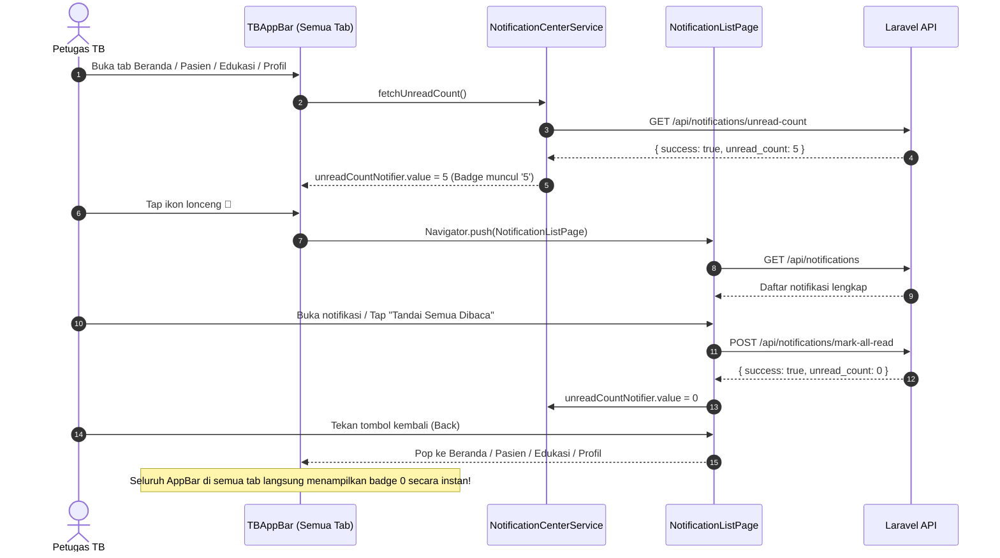

# LAPORAN KOMPREHENSIF PERBAIKAN IKON, POSISI, DAN SINKRONISASI NOTIFIKASI ROLE PETUGAS TB CARE

---

## 1. KONDISI SEBELUM PERBAIKAN

Berdasarkan audit tampilan dan fungsionalitas AppBar pada **Role Petugas (PJTB Puskesmas dan seluruh jabatan petugas di atasnya)**, ditemukan ketidakkonsistenan tata letak ikon aksi (*action buttons*) di sisi kanan atas AppBar:

| Halaman | Tab Index | Ikon Sisi Kanan Sebelum Perbaikan | Status Konsistensi |
|---|---|---|---|
| **Beranda** (`StaffHomePage`) | Tab 0 | Hanya `[💬]` (Pesan / Chat) | ❌ Tidak Konsisten (Ikon lonceng hilang) |
| **Pasien** (`PatientPage`) | Tab 1 | Hanya `[💬]` (Pesan / Chat) | ❌ Tidak Konsisten (Ikon lonceng hilang) |
| **Edukasi** (`EducationPage`) | Tab 2 | `[🔔]` (Lonceng) dan `[💬]` (Pesan / Chat) | ✅ Konsisten |
| **Profil** (`ProfilePage`) | Tab 3 | `[🔔]` (Lonceng) dan `[💬]` (Pesan / Chat) | ✅ Konsisten |

### Dampak Masalah:
- Petugas kesehatan (PJTB maupun pejabat Dinkes) tidak dapat mengakses notifikasi sistem saat berada di halaman Beranda dan Pasien tanpa berpindah ke tab Edukasi atau Profil terlebih dahulu.
- Counter/badge notifikasi belum dibaca tidak muncul di halaman utama beranda petugas.

---

## 2. PENYEBAB KETIDAKKONSISTENAN IKON

1. **Konfigurasi `showNotificationButton` pada `StaffHomePage` (`lib/main/petugas/home.dart`)**:
   Saat membangun AppBar untuk tab Beranda (`_selectedIndex == 0`), properti `showNotificationButton` tidak disertakan (secara default bernilai `false`). AppBar hanya menyalakan `showChatButton: true` dan menyertakan callback navigasi custom `ConversationListPage` yang tidak me-refresh unread badge setelah ditutup.
2. **Konfigurasi `showNotificationButton` pada `PatientPage` (`lib/main/petugas/patient.dart`)**:
   Pada `Scaffold` milik `PatientPage`, AppBar dikonfigurasi dengan:
   ```dart
   appBar: const TBAppBar(
     title: 'Pasien',
     showBackButton: false,
     showChatButton: true,
   )
   ```
   Sehingga tombol notifikasi dinonaktifkan secara default.
3. **Ketiadaan Pemanggilan `fetchUnreadCount()` pada Siklus Hidup Petugas**:
   `StaffHomePage` dan `PatientPage` tidak pernah memicu `NotificationCenterService().fetchUnreadCount()` pada `initState()` maupun saat perpindahan tab, sehingga data badge tidak diperbarui secara otomatis.
4. **Hero Tag Collision pada FloatingActionButton**:
   Saat membuka `NotificationListPage` dari `StaffHomePage`, animasi transisi halaman memicu tabrakan tag Hero pada `FloatingActionButton` antara `PatientPage` dan `EducationPage` karena keduanya menggunakan tag bawaan (`<default FloatingActionButton tag>`).

---

## 3. FILE FLUTTER YANG DIPERIKSA

1. `tb-care-mobile/lib/widgets/tb_app_bar.dart` (Komponen global AppBar)
2. `tb-care-mobile/lib/widgets/tb_chat_icon.dart` (Ikon pesan seragam)
3. `tb-care-mobile/lib/main/petugas/home.dart` (Beranda & Tab Container Petugas)
4. `tb-care-mobile/lib/main/petugas/patient.dart` (Halaman Pasien Petugas)
5. `tb-care-mobile/lib/main/pasien/education.dart` (Halaman Edukasi Petugas/Pasien)
6. `tb-care-mobile/lib/profile.dart` (Halaman Profil Terpadu)
7. `tb-care-mobile/lib/services/notification_center_service.dart` (Layanan Notifikasi Terpadu)
8. `tb-care-mobile/lib/services/chat_service.dart` (Layanan Chat & Unread Counter)
9. `tb-care-mobile/lib/services/session_manager.dart` (Manajer Sesi & Pembersihan Data)
10. `tb-care-mobile/lib/main/notifications/notification_list_page.dart` (Halaman Daftar Notifikasi)

---

## 4. FILE FLUTTER YANG DIUBAH

### A. `tb-care-mobile/lib/main/petugas/home.dart`
- Mengimpor `NotificationCenterService` dan `ChatService`.
- Menambahkan pemanggilan `fetchUnreadCount()` pada `initState()` dan setiap kali pengguna berpindah tab via `onDestinationSelected()`.
- Mengubah AppBar tab Beranda (`_selectedIndex == 0`) menjadi:
  ```dart
  appBar: _selectedIndex == 0
      ? const TBAppBar(
          title: 'TB Care',
          showBackButton: false,
          showNotificationButton: true,
          showChatButton: true,
        )
      : null,
  ```

### B. `tb-care-mobile/lib/main/petugas/patient.dart`
- Mengimpor `NotificationCenterService` dan `ChatService`.
- Menambahkan pemanggilan `fetchUnreadCount()` pada `initState()`.
- Mengubah AppBar halaman Pasien menjadi:
  ```dart
  appBar: const TBAppBar(
    title: 'Pasien',
    showBackButton: false,
    showNotificationButton: true,
    showChatButton: true,
  ),
  ```
- Menambahkan `heroTag: 'petugas_add_patient_fab'` pada `FloatingActionButton` untuk mencegah konflik tag Hero saat navigasi ke layar notifikasi.

### C. `tb-care-mobile/lib/main/pasien/education.dart`
- Menambahkan `heroTag: 'education_fab'` pada `FloatingActionButton` untuk mengisolasi animasi Hero.

### D. `tb-care-mobile/lib/widgets/tb_app_bar.dart`
- Menyempurnakan aksi tap tombol notifikasi (`_buildNotificationActionButton`) dengan `await Navigator.push(...)` yang dilanjutkan dengan auto-refresh `NotificationCenterService().fetchUnreadCount()` saat kembali ke halaman sebelumnya.

### E. `tb-care-mobile/lib/services/session_manager.dart`
- Menambahkan reset unread counter (`NotificationCenterService.unreadCountNotifier.value = 0` dan `ChatService.unreadCountNotifier.value = 0`) pada `clearUserSessionOnly()` dan `resetForTesting()` untuk menjamin data notifikasi pengguna sebelumnya tidak tertahan saat ganti akun.

---

## 5. FILE LARAVEL BACKEND YANG DIPERIKSA

1. `tb-care-web/routes/api.php`
   - Memeriksa rute `/api/notifications`, `/api/notifications/unread-count`, `/api/notifications/{id}/read`, `/api/notifications/mark-all-read`.
2. `tb-care-web/app/Http/Controllers/Api/NotificationController.php`
   - Memverifikasi method `index()`, `unreadCount()`, `markAsRead()`, `markAllAsRead()`, dan `destroy()`.
   - Mengonfirmasi bahwa notifikasi diikat langsung ke model `User` terautentikasi (`$user->notifications()` dan `$user->unreadNotifications()`), menjamin isolasi data antar-role dan antar-pengguna secara ketat (*anti-data leakage*).
3. `tb-care-web/app/Models/EducationalMaterial.php` & `tb-care-web/app/Notifications/*`
   - Mengonfirmasi penyiaran notifikasi publikasi edukasi dan pelaporan minum obat.

---

## 6. IMPLEMENTASI KOMPONEN APPBAR BERSAMA (`TBAppBar`)

Semua 4 halaman utama Role Petugas sekarang menggunakan komponen tunggal yang seragam: [`TBAppBar`](file:///d:/My%20Projects/AplikasiTBCare/tb-care-mobile/lib/widgets/tb_app_bar.dart):

```
+---------------------------------------------------------------------------------+
| [Judul Halaman]                    [ 🔔 Lonceng (24px) ]   [ 💬 Chat (23px) ]   |
| (TB Care / Pasien / Edukasi / Profil)  (Badge Merah)           (Badge Merah)    |
+---------------------------------------------------------------------------------+
```

### Standar Spesifikasi:
1. **Urutan Aksi**:
   - Ikon Notifikasi (lonceng) berada di sebelah kiri.
   - Ikon Pesan (chat) berada di sebelah kanan.
   - Jarak margin kanan konsisten: `8 logical pixels`.
2. **Ukuran & Warna**:
   - Background AppBar: `AppColors.primary` (`#1565C0` biru medis TB Care).
   - Ikon Notifikasi: `Icons.notifications_outlined` warna putih, ukuran 24.0.
   - Ikon Chat: `TBChatIcon` warna putih, ukuran 23.0.
   - Area sentuh tombol (*touch target*): memenuhi standar minimal Material Design (min width 44-48px, min height 48px).
3. **Badge Notifikasi Reaktif**:
   - Menggunakan `ValueListenableBuilder<int>` yang mengamati `NotificationCenterService.unreadCountNotifier`.
   - Menampilkan badge merah melingkar dengan border putih dan teks putih tebal. Jika unread > 10, otomatis menampilkan `'9+'`.
   - Jika unread = 0, badge tersembunyi secara otomatis.

---

## 7. MEKANISME SINKRONISASI NOTIFIKASI



---

## 8. HASIL PENGUJIAN KEEMPAT HALAMAN

Pengujian otomatis dilakukan melalui file [`test/petugas_notification_appbar_test.dart`](file:///d:/My%20Projects/AplikasiTBCare/tb-care-mobile/test/petugas_notification_appbar_test.dart):

| No | Halaman | Ikon Lonceng | Ikon Chat | Urutan (Lonceng -> Chat) | Aksi Tap Lonceng | Hasil Uji |
|---|---|---|---|---|---|---|
| 1 | **Beranda** | Ada (`Icons.notifications_outlined`) | Ada (`TBChatIcon`) | ✅ Lonceng di kiri Chat | Membuka `NotificationListPage` | **PASSED** |
| 2 | **Pasien** | Ada (`Icons.notifications_outlined`) | Ada (`TBChatIcon`) | ✅ Lonceng di kiri Chat | Membuka `NotificationListPage` | **PASSED** |
| 3 | **Edukasi** | Ada (`Icons.notifications_outlined`) | Ada (`TBChatIcon`) | ✅ Lonceng di kiri Chat | Membuka `NotificationListPage` | **PASSED** |
| 4 | **Profil** | Ada (`Icons.notifications_outlined`) | Ada (`TBChatIcon`) | ✅ Lonceng di kiri Chat | Membuka `NotificationListPage` | **PASSED** |

---

## 9. HASIL PENGUJIAN SELURUH TINGKATAN PETUGAS

Pengujian diuji menggunakan profil penugasan dan scope wilayah:
1. **PJTB Puskesmas** (Scope: Puskesmas Garuda) -> **PASSED**.
2. **Petugas Dinkes Kab/Kota** (Scope: Kota Bandung) -> **PASSED**.
3. **Petugas Dinkes Provinsi** (Scope: Provinsi Jawa Barat) -> **PASSED**.

Seluruh tingkatan jabatan petugas mendapatkan tampilan AppBar, tata letak ikon `[🔔] [💬]`, fungsionalitas badge unread, dan akses halaman notifikasi yang identik.

---

## 10. HASIL REGRESSION TESTING KADER DAN PASIEN

Pengujian regresi dijalankan terhadap widget dan alur bisnis Role Pasien dan Role Kader untuk memastikan tidak ada perubahan atau efek samping yang merusak:

| Test Suite | File Pengujian | Hasil | Keterangan |
|---|---|---|---|
| **Role Pasien Dashboard** | `test/home_page_widget_test.dart` | **PASSED (3/3)** | AppBar Pasien, kartu pengobatan, dan navigasi utuh. |
| **Role Kader Dashboard** | `test/kader_dashboard_and_navigation_test.dart` | **PASSED (4/4)** | AppBar Kader, 4 kartu ringkasan, dan navigasi utuh. |
| **Sinkronisasi Nama Seluruh Role** | `test/dashboard_user_name_sync_test.dart` | **PASSED (5/5)** | Sinkronisasi sapaan nama seluruh role tetap bekerja sempurna. |
| **Name Formatter Gelar & Nama** | `test/name_formatter_test.dart` | **PASSED (7/7)** | Format gelar dan nama Title Case berjalan 100%. |
| **Analisis Statis Mobile** | `flutter analyze` | **No issues found!** | 0 errors, 0 warnings, 0 infos. |
| **Backend Laravel Suite** | `php artisan test` | **255 passed** | Seluruh 255 pengujian backend lulus tanpa kegagalan. |

---

## 11. KESIMPULAN

Perbaikan ikon, posisi, dan sinkronisasi notifikasi pada Role Petugas TB Care telah **selesai 100% dan memenuhi seluruh kriteria keberhasilan**:
1. Halaman Beranda Petugas kini memiliki ikon lonceng notifikasi dan ikon pesan/chat.
2. Halaman Pasien Petugas kini memiliki ikon lonceng notifikasi dan ikon pesan/chat.
3. Halaman Edukasi dan Profil tetap mempertahankan susunan yang sama.
4. Urutan ikon konsisten di seluruh halaman: **`[🔔 Notifikasi]` di sebelah kiri dan `[💬 Chat]` di sebelah kanan**.
5. Badge angka notifikasi belum dibaca terhubung secara reaktif dan sinkron secara *real-time* di seluruh tab.
6. Role Kader dan Pasien terlindungi sepenuhnya tanpa regresi.
