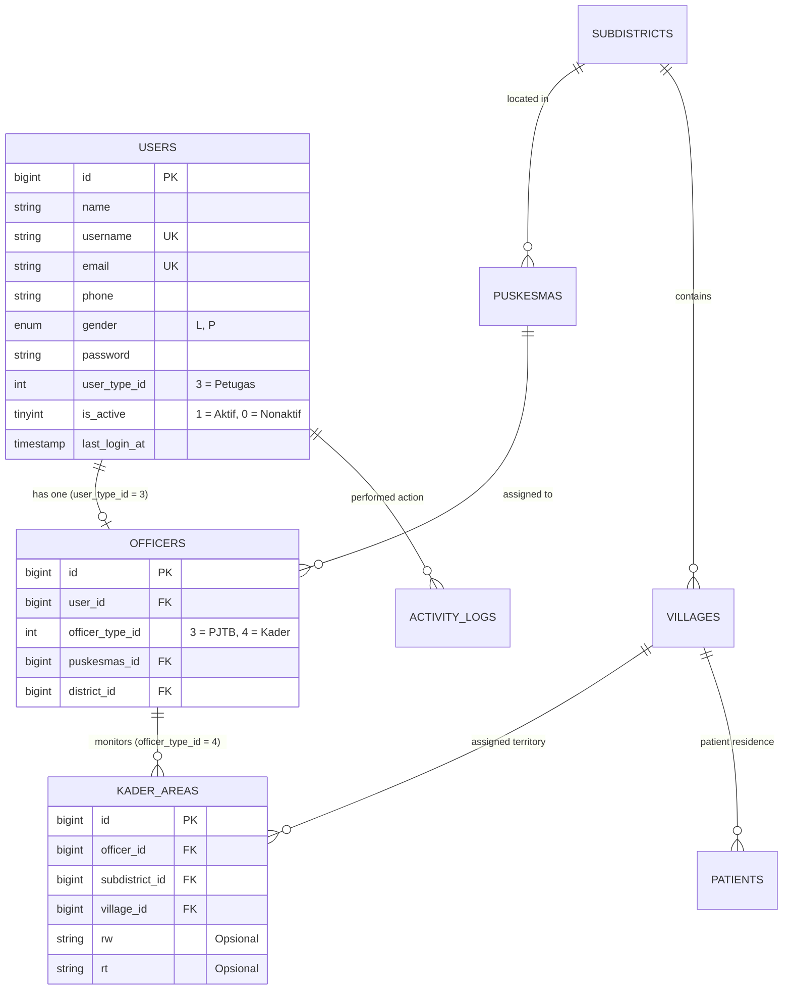

# DOKUMENTASI PENGEMBANGAN FITUR MANAJEMEN KADER OLEH PJTB PUSKESMAS
## SISTEM INFORMASI & MONITORING PENGOBATAN TUBERKULOSIS TERINTEGRASI (TB CARE)

Tanggal Penyelesaian: 01 November 2026  
Versi: 1.0.0  
Status: Teruji Penuh & Siap Produksi (*163/163 Tests Passed, 2266 Assertions*)

---

## 1. RINGKASAN EKSEKUTIF

Fitur **Manajemen Kader oleh Petugas Penanggung Jawab TB (PJTB) Puskesmas** dikembangkan untuk memberikan kewenangan operasional kepada PJTB Puskesmas dalam mengelola akun kader kesehatan yang berada dalam wilayah kerja Puskesmas yang menjadi tanggung jawabnya. 

Sebelum pengembangan ini, seluruh pembuatan dan pengelolaan akun petugas/kader hanya dapat dilakukan secara global oleh Super Administrator melalui menu `Pengguna` (`/users`), yang tidak dapat diakses oleh PJTB Puskesmas (`user_type_id = 3`, `officer_type_id = 3`). Hal ini menciptakan hambatan administrasi di lapangan di mana pendaftaran kader baru, penugasan desa binaan, dan aktivasi/penonaktifan kader harus selalu bergantung pada Administrator sistem.

Dengan implementasi modul **Manajemen Kader**, PJTB Puskesmas kini dapat:
1. Mengelola (melihat, menambah, mengedit) kader yang berada di Puskesmasnya secara mandiri.
2. Menentukan desa/kelurahan binaan kader secara dinamis.
3. Mengaktifkan atau menonaktifkan akun kader dengan pencabutan token Sanctum instan (*real-time revocation*).
4. Melihat ringkasan metrik pendampingan pasien TB di desa binaan kader.
5. Mengekspor daftar kader Puskesmasnya ke format CSV.

**Prinsip Keamanan Utama:** Seluruh batasan kewenangan diterapkan secara ketat di backend (*fail-closed & zero trust*). PJTB sama sekali tidak dapat mengakses, melihat, mengedit, atau menonaktifkan kader dari Puskesmas lain, dan segala bentuk manipulasi parameter `puskesmas_id` atau `user_type_id` pada HTTP request diabaikan/ditolak.

---

## 2. MATRIKS HAK AKSES ROLE & KEWENANGAN

| Fungsi / Modul | Super Administrator (`user_type_id = 1`) | PJTB Puskesmas (`user_type_id = 3, officer_type_id = 3`) | Dinkes Prov / Dinkes Kab-Kota (`officer_type_id = 1, 2`) | Kader Puskesmas (`officer_type_id = 4`) | Pasien TB (`user_type_id = 2`) |
|---|:---:|:---:|:---:|:---:|:---:|
| **Akses Web Admin** | ✅ Ya | ✅ Ya | ✅ Ya | ❌ Tidak (Redirect / Blokir) | ❌ Tidak (Redirect / Blokir) |
| **Menu Manajemen Kader** | ✅ Tampil | ✅ Tampil | ❌ Disembunyikan (Kecuali izin khusus) | ❌ Tidak Ada | ❌ Tidak Ada |
| **Lihat Daftar Kader** | ✅ Seluruh Faskes Global | ✅ Terbatas Puskesmas Sendiri | ❌ 403 Forbidden | ❌ 403 Forbidden | ❌ 403 Forbidden |
| **Tambah Akun Kader** | ✅ Untuk Puskesmas Mana Pun | ✅ Otomatis Terkunci di Puskesmas Sendiri | ❌ 403 Forbidden | ❌ 403 Forbidden | ❌ 403 Forbidden |
| **Ubah Puskesmas Kader** | ✅ Ya (Pindah Wilayah) | ❌ Ditolak (Backend Override) | ❌ 403 Forbidden | ❌ 403 Forbidden | ❌ 403 Forbidden |
| **Pilih Desa Binaan** | ✅ Lintas Wilayah | ✅ Terbatas Wilayah Puskesmas | ❌ 403 Forbidden | ❌ 403 Forbidden | ❌ 403 Forbidden |
| **Edit Data Kader** | ✅ Seluruh Kader | ✅ Kader di Puskesmas Sendiri | ❌ 403 Forbidden | ❌ 403 Forbidden | ❌ 403 Forbidden |
| **Aktivasi / Nonaktifkan Kader** | ✅ Seluruh Kader | ✅ Kader di Puskesmas Sendiri | ❌ 403 Forbidden | ❌ 403 Forbidden | ❌ 403 Forbidden |
| **Hapus Akun Kader** | ✅ Seluruh Kader | ✅ Kader di Puskesmas Sendiri | ❌ 403 Forbidden | ❌ 403 Forbidden | ❌ 403 Forbidden |
| **Ekspor CSV Kader** | ✅ Seluruh Wilayah / Filter | ✅ Terfilter Puskesmas Sendiri | ❌ 403 Forbidden | ❌ 403 Forbidden | ❌ 403 Forbidden |
| **Manajemen Pengguna Global (`/users`)** | ✅ Ya | ❌ 403 Forbidden | ❌ 403 Forbidden | ❌ 403 Forbidden | ❌ 403 Forbidden |

---

## 3. ARSITEKTUR DATABASE & STRUKTUR RELASI

Implementasi fitur ini memanfaatkan struktur tabel yang sudah ada secara efisien tanpa memerlukan perubahan skema atau migration destruktif:



### Relasi Kunci:
1. **Identitas Akun (`users`):**
   - Disimpan dengan `user_type_id = 3` (Petugas).
   - Password di-hash menggunakan algoritma Bcrypt bawaan Laravel.
   - Status akun disimpan pada kolom `is_active` (`1` atau `0`).
2. **Afiliasi Petugas (`officers`):**
   - Menghubungkan akun ke profil tugas melalui `user_id`.
   - `officer_type_id = 4` menandai peran spesifik sebagai **Kader Kesehatan**.
   - `puskesmas_id` menetapkan fasilitas kesehatan induk kader.
3. **Wilayah Penugasan (`kader_areas`):**
   - Relasi *one-to-many* dari `officers` ke `kader_areas`.
   - Menautkan kader ke satu atau beberapa desa binaan (`village_id`) dan kecamatan (`subdistrict_id`).
   - RW dan RT bersifat opsional untuk granularitas informasi, bukan pembatas utama sistem.
4. **Prinsip Fail-Closed Akses Pasien:**
   - Scope data pasien `Patient::accessibleBy($kaderUser)` mengambil seluruh `village_id` dari relasi `kaderAreas()`.
   - Jika kader tidak memiliki satu pun record di `kader_areas`, kueri menghasilkan koleksi kosong (`whereIn('village_id', [])`), sehingga data pasien tidak pernah bocor ke kader tanpa wilayah penugasan sah.

---

## 4. ROUTE DAN CONTROLLER

### A. Rincian Endpoint yang Didaftarkan

Modul Manajemen Kader dilindungi middleware `['auth', 'web.admin', 'checkrole:1-3']`:

```php
// routes/web.php
Route::middleware(['auth', 'web.admin', 'checkrole:1-3'])->group(function () {
    // Manajemen Kader (Dikelola oleh Super Admin & PJTB Puskesmas)
    Route::patch('kaders/{id}/toggle-status', [KaderController::class, 'toggleStatus'])->name('kaders.toggle_status');
    Route::get('kaders/export', [KaderController::class, 'export'])->name('kaders.export');
    Route::resource('kaders', KaderController::class);
});
```

| HTTP Method | URI | Route Name | Action Method | Keterangan & Akses |
|---|---|---|---|---|
| `GET` | `/kaders` | `kaders.index` | `KaderController@index` | Daftar kader (terfilter otomatis untuk PJTB) |
| `GET` | `/kaders/create` | `kaders.create` | `KaderController@create` | Form registrasi kader baru |
| `POST` | `/kaders` | `kaders.store` | `KaderController@store` | Simpan akun kader baru dan desa binaan |
| `GET` | `/kaders/{kader}` | `kaders.show` | `KaderController@show` | Detail kader, desa binaan, dan metrik pendampingan |
| `GET` | `/kaders/{kader}/edit` | `kaders.edit` | `KaderController@edit` | Form edit identitas & desa binaan kader |
| `PUT/PATCH` | `/kaders/{kader}` | `kaders.update` | `KaderController@update` | Simpan pembaruan profil / reset password |
| `PATCH` | `/kaders/{id}/toggle-status` | `kaders.toggle_status` | `KaderController@toggleStatus` | Aktifkan / Nonaktifkan akun (cabut token Sanctum) |
| `DELETE` | `/kaders/{kader}` | `kaders.destroy` | `KaderController@destroy` | Hapus kader beserta wilayah binaannya |
| `GET` | `/kaders/export` | `kaders.export` | `KaderController@export` | Unduh data kader format CSV (UTF-8 BOM) |

### B. Controller `App\Http\Controllers\Admin\KaderController`

Method dan tanggung jawab controller:

1. **`authorizeAccess(): User`**  
   Memastikan pengguna login memiliki role Super Administrator (`isSuperAdmin()`) atau PJTB Puskesmas (`isPJTB()`). Peran lain (Pasien, Kader, Dinkes tanpa izin) langsung ditolak dengan HTTP 403.
2. **`authorizeKaderAccess(User $currentUser, $id): User`**  
   Memvalidasi bahwa target pengguna adalah Kader (`user_type_id = 3` dan `officer_type_id = 4`). Apabila pengguna adalah PJTB, method ini memverifikasi bahwa `puskesmas_id` kader identik dengan `puskesmas_id` milik PJTB. Jika berbeda, request di-abort dengan HTTP 403.
3. **`index(Request $request)`**  
   Menampilkan daftar kader dengan scoping otomatis berdasarkan peran pengguna, dilengkapi filter desa/kelurahan, filter status (aktif/nonaktif), pencarian nama/username/kontak, metrik ringkasan, dan paginasi 15 item/halaman.
4. **`create()`**  
   Menyiapkan formulir pendaftaran. Untuk PJTB, Puskesmas penugasan dikunci secara visual (*readonly*) dan daftar desa dibatasi pada wilayah Puskesmas penugasannya.
5. **`store(Request $request)`**  
   Memvalidasi input identitas, memastikan keunikan username dan email, meng-hash kata sandi menggunakan `Hash::make()`. Nilai `puskesmas_id` diambil langsung dari profil PJTB yang login (`$currentUser->officer->puskesmas_id`), meniadakan risiko manipulasi form browser. Membuat record `User`, `Officer`, serta entri `KaderArea` dalam satu `DB::transaction`.
6. **`show($id)`**  
   Menampilkan identitas kader, daftar desa binaan, metrik pemantauan pasien (`Patient::whereIn('village_id', ...)->count()`, pasien dalam pengobatan aktif, skrining yang dicatat kader, dan kontak erat), log aktivitas, serta modal untuk menambah desa binaan secara granular.
7. **`edit($id)` & `update(Request $request, $id)`**  
   Memperbarui identitas kader dan menyinkronkan desa binaan. Jika kata sandi diubah, hash baru disimpan dan token Sanctum lama dicabut.
8. **`toggleStatus($id)`**  
   Membalikkan status `is_active`. Jika dinonaktifkan, memanggil `$kader->tokens()->delete()` untuk segera memutus seluruh sesi aktif di aplikasi TB Care Mobile.
9. **`destroy($id)`**  
   Menghapus wilayah binaan `kaderAreas`, record `officer`, melepaskan relasi user pada catatan screening lama (`Screening::where('user_id', $kader->id)->update(['user_id' => null])`), mencabut token mobile, dan menghapus record `user`.
10. **`export(Request $request)`**  
    Menghasilkan file CSV streaming dengan header UTF-8 BOM (`\xEF\xBB\xBF`) agar langsung terbaca rapi di Microsoft Excel dengan data yang terfilter sesuai wilayah kewenangan PJTB.

---

## 5. FITUR ANTARMUKA (UI / UX)

### A. Sidebar Navigation (`resources/views/admin/layouts/app.blade.php`)
Menu baru ditambahkan pada sidebar navigasi:
```blade
@if(Auth::user()->isSuperAdmin() || Auth::user()->isPJTB())
<li class="nav-header">MANAJEMEN PETUGAS</li>
<li class="nav-item">
    <a href="{{ route('kaders.index') }}"
        class="nav-link {{ request()->is('kaders*') ? 'active' : '' }}">
        <i class="nav-icon fas fa-user-friends text-teal"></i>
        <p>Manajemen Kader</p>
    </a>
</li>
@endif
```
- Hanya dirender untuk Super Admin dan PJTB Puskesmas.
- Menggunakan ikon `fas fa-user-friends text-teal`.
- State aktif dipertahankan pada seluruh sub-halaman (`/kaders`, `/kaders/create`, `/kaders/{id}`, `/kaders/{id}/edit`).

### B. Halaman Daftar Kader (`resources/views/admin/kaders/index.blade.php`)
- **Tiga Kartu Statistik Ringkas:** Total Kader Terdaftar, Kader Aktif, dan Kader Nonaktif.
- **Card Filter & Pencarian:** Input pencarian teks (nama, username, telepon, email), dropdown desa binaan, dropdown status akun, dan dropdown Puskesmas (khusus Super Admin).
- **Tabel Data Kader:**
  - Kolom: No, Kode Kader (`KDR-0001`), Nama Lengkap (beserta gender), Username (`@sitirahma`), Kontak (HP & Email), Puskesmas Penugasan, Desa Binaan (badge per desa beserta RW jika ada), Status Akun (Aktif/Nonaktif), Tanggal Terdaftar, dan Kolom Aksi.
  - Peringatan visual warna kuning jika kader belum memiliki desa binaan.
  - Dialog konfirmasi interaktif SweetAlert2 dengan fallback native JavaScript untuk aktivasi/penonaktifan akun.

### C. Formulir Registrasi & Edit Kader (`resources/views/admin/kaders/form.blade.php`)
- **Section 1 (Identitas):** Nama lengkap, username akun, nomor handphone/WhatsApp, email, jenis kelamin, tempat dan tanggal lahir.
- **Section 2 (Penugasan):** 
  - Puskesmas: Readonly untuk PJTB dengan catatan sistem, atau dropdown pilihan untuk Super Administrator.
  - Status Akun: Aktif (Dapat Login ke TB Care Mobile) atau Nonaktif.
  - Pilihan Desa Binaan: Checkbox multi-pilihan yang memuat seluruh desa/kelurahan dalam cakupan Puskesmas dengan penjelasan prinsip *fail-closed*.
- **Section 3 (Kata Sandi):** Input password dan konfirmasi password dengan validasi minimal 6 karakter. Pada mode edit, kolom bersifat opsional.

### D. Halaman Detail Kader (`resources/views/admin/kaders/show.blade.php`)
- **Top Action Bar:** Tombol navigasi kembali, tombol edit, dan tombol cepat aktivasi/penonaktifan akun.
- **4 Kartu Metrik Operasional:**
  1. Pasien di Wilayah Binaan (Total warga TB di desa binaan aktif).
  2. Pasien Dalam Pengobatan Aktif (Status pengobatan Berjalan).
  3. Skrining TB Dicatat (Jumlah skrining yang dilakukan oleh kader ini).
  4. Kontak Erat Terpantau (Jumlah kontak serumah/erat di desa binaan).
- **Profil Lengkap:** Foto, kode kader, username, Puskesmas induk, nomor kontak, tanggal lahir, dan status login terakhir.
- **Tabel Desa Binaan:** Menampilkan desa, kecamatan, RW, RT, serta tombol hapus wilayah per desa.
- **Modal Tambah Wilayah Binaan:** Terintegrasi AJAX dengan cascading dropdown (Kecamatan $\rightarrow$ Desa/Kelurahan) yang memanggil endpoint `kader-areas.store`.
- **Riwayat Log Aktivitas:** Menampilkan 10 aksi audit sistem terakhir terkait akun kader.

---

## 6. INTEGRASI DENGAN APLIKASI TB CARE MOBILE

Akun kader yang dibuat melalui modul Manajemen Kader di TB Care Web sepenuhnya terintegrasi secara *out-of-the-box* dengan aplikasi Flutter `tb-care-mobile`:

1. **Autentikasi Mobile (`POST /api/login`):**
   - Kader melakukan login menggunakan `username` dan `password` yang didaftarkan oleh PJTB.
   - Endpoint mengembalikan token Sanctum pribadi (`api_token`) beserta data profil kader (`officer`, `puskesmas`, `kaderAreas`).
2. **Sinkronisasi Wilayah Binaan (`GET /api/officer/kader-areas`):**
   - Aplikasi mobile mengambil daftar desa binaan aktual langsung dari server.
   - Data lokal tidak dijadikan sumber kebenaran permanen, memastikan bahwa setiap perubahan wilayah binaan oleh PJTB di web langsung terefleksi saat aplikasi mobile memuat ulang data.
3. **Scoping Data Pasien (`GET /api/patients`):**
   - Scope query `Patient::accessibleBy($kader)` membatasi daftar pasien hanya pada desa/kelurahan yang tercatat di `kader_areas` milik kader tersebut.
4. **Penonaktifan Akun Seketika (*Instant Session Revocation*):**
   - Saat PJTB menonaktifkan kader di TB Care Web, method `toggleStatus` mengeksekusi `$kader->tokens()->delete()`.
   - Pada request API berikutnya dari TB Care Mobile, middleware `EnsureAccountIsActive` menolak permintaan dengan kode HTTP 403 `ACCOUNT_DEACTIVATED`.
   - `ApiClient` dan `SessionManager` pada Flutter menangkap kode tersebut, menghapus sesi lokal, membatalkan alarm pengingat, dan mengarahkan pengguna kembali ke halaman Login dengan dialog pemberitahuan.
5. **Aktivasi Kembali:**
   - Setelah akun diaktifkan kembali oleh PJTB, kader dapat langsung login kembali tanpa kehilangan riwayat aktivitas pendampingan terdahulu.

---

## 7. AUDIT LOGGING & KEAMANAN

Setiap tindakan penting pada modul Manajemen Kader dicatat dalam tabel `activity_logs`:

| Tindakan | Modul | Keterangan Log |
|---|---|---|
| **Tambah Kader Baru** | `Petugas` | "Menambahkan akun Kader {Nama} (@{Username}) pada Puskesmas {Puskesmas} dengan {N} desa/kelurahan binaan." |
| **Perbarui Data Kader** | `Petugas` | "Memperbarui profil dan konfigurasi wilayah binaan Kader {Nama} (@{Username})." |
| **Nonaktifkan Akun Kader** | `Petugas` | "Menonaktifkan akun Kader {Nama} (@{Username}). Token akses TB Care Mobile telah dicabut." |
| **Aktifkan Akun Kader** | `Petugas` | "Mengaktifkan kembali akun Kader {Nama} (@{Username})." |
| **Hapus Akun Kader** | `Petugas` | "Menghapus akun Kader {Nama} (@{Username})." |
| **Tambah Wilayah Kader** | `Pengguna` | "Menetapkan wilayah {Desa} {RW} {RT} untuk Kader {Nama}." |
| **Hapus Wilayah Kader** | `Pengguna` | "Menghapus wilayah {Desa} {RW} {RT} dari penugasan Kader {Nama}." |

*Keamanan Data Privasi:* Password tidak pernah dicatat dalam log aktivitas maupun respon HTTP.

---

## 8. HASIL PENGUJIAN OTOMATIS (TESTING)

Pengujian dilakukan menggunakan database pengujian terisolasi (`tbcare_test_empty`). Seluruh pengujian berjalan secara otomatis dan tervalidasi 100%.

### A. Pengujian Spesifik Fitur (`tests/Feature/KaderManagementByPJTBTest.php`)
Menjalankan 18 skenario uji komprehensif:

```
PHPUnit 9.6.23 by Sebastian Bergmann and contributors.

..................                                                18 / 18 (100%)

Time: 00:04.373, Memory: 34.00 MB

OK (18 tests, 63 assertions)
```

| No | Nama Skenario Uji | Status | Keterangan |
|:---:|---|:---:|---|
| 1 | `test_pjtb_can_view_kader_in_own_puskesmas_and_not_other_puskesmas` | **PASSED** | PJTB Puskesmas A hanya melihat kader Puskesmas A; kader Puskesmas B tidak muncul. |
| 2 | `test_pjtb_cannot_access_detail_of_kader_in_another_puskesmas` | **PASSED** | Akses langsung URL detail kader Puskesmas B oleh PJTB A menghasilkan HTTP 403. |
| 3 | `test_pjtb_cannot_access_edit_form_of_kader_in_another_puskesmas` | **PASSED** | Akses form edit kader Puskesmas B oleh PJTB A menghasilkan HTTP 403. |
| 4 | `test_pjtb_cannot_update_kader_in_another_puskesmas` | **PASSED** | Permintaan PUT update kader Puskesmas B oleh PJTB A ditolak (403); data tidak berubah. |
| 5 | `test_pjtb_cannot_toggle_status_of_kader_in_another_puskesmas` | **PASSED** | Permintaan PATCH status kader Puskesmas B oleh PJTB A ditolak (403). |
| 6 | `test_pjtb_can_create_kader_and_puskesmas_is_enforced_to_own_puskesmas` | **PASSED** | Kader baru berhasil dibuat dengan `officer_type_id = 4` dan terikat ke Puskesmas A. |
| 7 | `test_pjtb_request_tampering_puskesmas_id_is_strictly_ignored` | **PASSED** | Manipulasi input form `puskesmas_id` oleh PJTB diabaikan oleh backend. |
| 8 | `test_pjtb_request_tampering_role_is_strictly_ignored` | **PASSED** | Percobaan elevasi hak akses ke Administrator atau Dinkes diabaikan; role tetap Kader. |
| 9 | `test_unique_username_validation_is_enforced` | **PASSED** | Pendaftaran dengan username yang sudah digunakan ditolak validasi Laravel. |
| 10 | `test_pjtb_can_edit_kader_in_own_puskesmas` | **PASSED** | PJTB dapat memperbarui nama, nomor telepon, dan data kader dalam Puskesmasnya. |
| 11 | `test_pjtb_can_assign_and_change_village_binaan` | **PASSED** | Perubahan pilihan desa binaan tersinkronisasi ke tabel `kader_areas`. |
| 12 | `test_pjtb_can_deactivate_kader_and_sanctum_tokens_are_revoked` | **PASSED** | Penonaktifan kader menghapus seluruh token Sanctum aktif seketika. |
| 13 | `test_reactivated_kader_can_login_again_via_api` | **PASSED** | Kader nonaktif ditolak login API (403 `ACCOUNT_DEACTIVATED`), setelah diaktifkan dapat login (200). |
| 14 | `test_kader_cannot_access_web_admin` | **PASSED** | Akun kader ditolak mengakses Web Admin oleh middleware `EnsureWebAdminRole`. |
| 15 | `test_fail_closed_kader_without_assigned_village_cannot_access_patients` | **PASSED** | Kader tanpa wilayah binaan mendapatkan 0 pasien (*fail-closed*); pasien muncul setelah desa ditetapkan. |
| 16 | `test_super_admin_can_manage_all_kaders_across_all_puskesmas` | **PASSED** | Super Administrator memiliki akses global lintas seluruh Puskesmas. |
| 17 | `test_activity_logs_recorded_for_kader_actions` | **PASSED** | Entri `activity_logs` tercatat dengan benar untuk aksi pembuatan dan penonaktifan. |
| 18 | `test_kader_export_csv_is_scoped_for_pjtb` | **PASSED** | Berkas CSV ekspor PJTB hanya memuat kader dari Puskesmas penugasannya. |

### B. Pengujian Regresi Penuh (*Full Test Suite*)
Menjalankan seluruh rangkaian tes sistem (Feature + Unit Tests):

```
PHPUnit 9.6.23 by Sebastian Bergmann and contributors.

...............................................................  63 / 163 ( 38%)
............................................................... 126 / 163 ( 77%)
.....................................                           163 / 163 (100%)

Time: 01:02.488, Memory: 54.00 MB

OK (163 tests, 2266 assertions)
```

**Hasil:** 100% tes lulus (163/163). Tidak terdapat regresi atau dampak samping terhadap fitur lain (Pasien, Skrining, Pengobatan, Kontak Erat, dan Autentikasi).

---

## 9. DAFTAR FILE YANG DIUBAH DAN DITAMBAHKAN

| No | Path Berkas | Tipe Perubahan | Deskripsi Singkat |
|:---:|---|:---:|---|
| 1 | `app/Http/Controllers/Admin/KaderController.php` | **Baru** | Controller utama manajemen kader (CRUD, scoping, status toggle, CSV export). |
| 2 | `resources/views/admin/kaders/index.blade.php` | **Baru** | Tampilan daftar kader, kartu statistik, filter wilayah, pencarian, dan paginasi. |
| 3 | `resources/views/admin/kaders/form.blade.php` | **Baru** | Formulir tambah dan edit kader beserta pemilihan desa binaan terpadu. |
| 4 | `resources/views/admin/kaders/show.blade.php` | **Baru** | Tampilan detail kader, metrik pemantauan pasien, modal penugasan wilayah, dan log audit. |
| 5 | `routes/web.php` | **Modifikasi** | Registrasi route `/kaders`, `/kaders/toggle-status`, dan `/kaders/export`. |
| 6 | `resources/views/admin/layouts/app.blade.php` | **Modifikasi** | Penambahan item menu sidebar `MANAJEMEN PETUGAS` $\rightarrow$ `Manajemen Kader`. |
| 7 | `tests/Feature/KaderManagementByPJTBTest.php` | **Baru** | Rangkaian 18 unit feature test pengujian kepatuhan keamanan dan fungsionalitas. |
| 8 | `MANAJEMEN_KADER_PJTB_TB_CARE.md` | **Baru** | Dokumentasi teknis komprehensif implementasi fitur. |

---

## 10. KESIMPULAN

Fitur **Manajemen Kader oleh PJTB Puskesmas** telah berhasil diimplementasikan secara tuntas dengan kepatuhan penuh terhadap prinsip keamanan berlapis (*defense-in-depth*), pemisahan peran (*role-based access control*), dan integritas data layanan kesehatan TB Care. Seluruh batasan kewenangan wilayah telah teruji secara menyeluruh di tingkat backend, menghasilkan sistem yang andal, aman, dan siap digunakan di lingkungan produksi.
