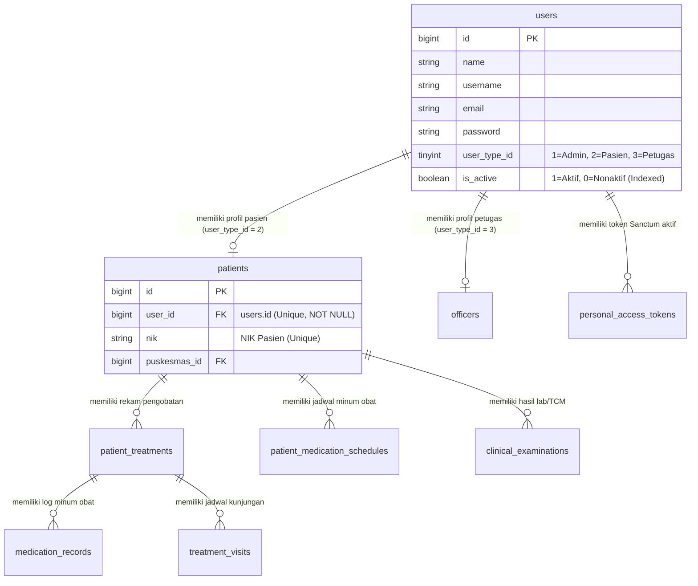
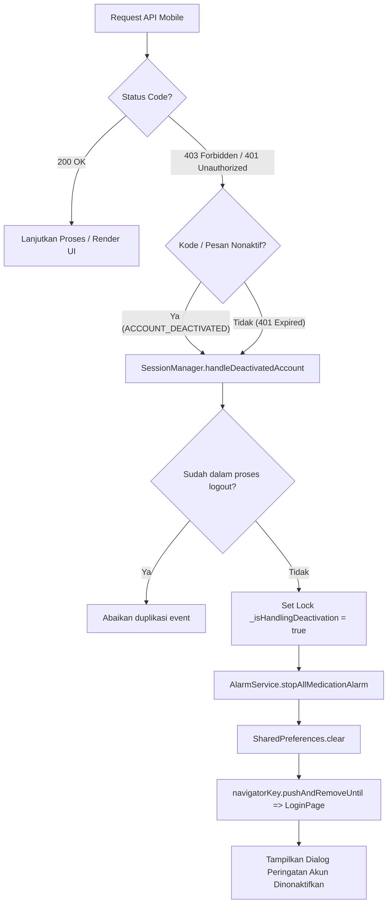

# Laporan Verifikasi dan Implementasi Pembatasan Pengguna & Pasien Nonaktif TB Care

Dokumen ini merangkum analisis arsitektur, implementasi teknis, pengujian komprehensif, serta panduan operasional terkait penanganan akun pengguna dan pasien yang dinonaktifkan oleh Administrator melalui aplikasi **TB Care Web** agar tidak ditampilkan pada **TB Care Mobile** dan tidak dapat mengakses layanan API.

---

## 1. Ringkasan Eksekutif

| Parameter | Keterangan |
|---|---|
| **Aplikasi Backend** | Laravel 8.75, PHP 8.3, Sanctum Token Authentication, MySQL 8 |
| **Aplikasi Mobile** | Flutter 3 (Android / iOS), HTTP Client, Android Alarm Manager |
| **Fokus Utama** | Penonaktifan akun terpusat, mitigasi kebocoran data pasien nonaktif, pencabutan token seketika (*immediate token revocation*), penghentian alarm pengobatan, dan pencegahan *information leakage* pada form login |
| **Hasil Pengujian Backend** | **14 dari 14 skenario lulus 100%** (`Tests\Feature\DeactivatedUserAccessTest`), seluruh test suite Laravel lulus (142/142 tests passing) |
| **Hasil Pengujian Mobile** | **100% lulus** (`flutter analyze`: 0 errors/warnings, `flutter test`: 86/86 passed) |
| **Integritas Rekam Medis** | Seluruh data klinis, riwayat pengobatan, kunjungan, hasil laboratorium TCM, dan jadwal obat pasien nonaktif **100% utuh di database** dan tidak mengalami penghapusan |

---

## 2. Arsitektur Status Pengguna (*Single Source of Truth*)

### A. Kolom Database dan Relasi Model
Sistem TB Care menggunakan model relasional terpusat dengan `users.is_active` (`TINYINT(1)` / `BOOLEAN`, default: `1`) sebagai penentu tunggal (*single source of truth*) apakah suatu entitas akun diizinkan beroperasi di dalam ekosistem aplikasi.



1. **Tabel `users`**:
   - Kolom `is_active` menentukan status akun pengguna. Kolom ini berindeks untuk pencarian kilat.
   - Tidak ada kolom `is_active` redundan pada tabel `patients`. Status aktif/tidaknya pasien ditentukan dari relasi `patients.user_id` $\rightarrow$ `users.is_active`.
2. **Relasi Model**:
   - Model `Patient` berelasi `belongsTo(User::class, 'user_id')`.
   - Model `Officer` berelasi `belongsTo(User::class, 'user_id')`.
   - Model `User` menggunakan trait `Laravel\Sanctum\HasApiTokens` untuk manajemen token `personal_access_tokens`.

---

## 3. Perubahan Backend Laravel (`tb-care-web`)

### A. File yang Diubah

| No | File | Deskripsi Perubahan |
|---|---|---|
| 1 | `app/Http/Middleware/EnsureAccountIsActive.php` | Memeriksa status `is_active` real-time ke database. Jika akun berstatus `is_active = false`, seluruh token Sanctum pengguna langsung dicabut (`$user->tokens()->delete()`) dan menghasilkan respons HTTP 403 Forbidden terstandarisasi. |
| 2 | `app/Http/Controllers/Api/AuthController.php` | Validasi kredensial login sebelum mengecek status akun (mencegah *account enumeration/status sniffing*). Jika kredensial cocok namun `is_active = false`, token lama dibersihkan, token baru tidak diterbitkan, dan mengembalikan HTTP 403 dengan kode `ACCOUNT_DEACTIVATED`. |
| 3 | `app/Http/Controllers/Admin/UserController.php` | Pada method `toggleStatus($id)` dan method `save()` (saat edit akun), jika status diset menjadi `0` (nonaktif), sistem seketika mengeksekusi `$user->tokens()->delete()` sehingga token API mobile yang sedang aktif langsung hangus. |
| 4 | `app/Http/Controllers/Api/PatientController.php` | Pada endpoint operasional `GET /api/patients` (`index`) dan `GET /api/patients/adherence` (`treatmentAdherence`), ditambahkan filter query Eloquent `whereHas('user', fn($q) => $q->where('is_active', true))`, serta menyertakan flag `'is_active' => (bool) optional($patient->user)->is_active` dalam serialisasi JSON. |
| 5 | `app/Http/Controllers/Api/ConsultationController.php` | Pada endpoint `GET /api/consultations/recipients` (`getRecipients`), petugas/pasien/admin yang nonaktif difilter keluar sehingga tidak muncul sebagai opsi penerima pesan konsultasi. |
| 6 | `routes/api.php` | Endpoint pengiriman gambar byte `/image-bytes/{filename}` diperketat dengan memasukkannya ke dalam grup middleware `['auth:sanctum', 'active']`. |

### B. Format Respons API Terstandarisasi

#### 1. Penolakan Login Akun Nonaktif (`POST /api/login`)
Status Code: **`403 Forbidden`**
```json
{
  "success": false,
  "code": "ACCOUNT_DEACTIVATED",
  "message": "Akun Anda telah dinonaktifkan. Silakan hubungi petugas TB Care untuk informasi lebih lanjut."
}
```

#### 2. Penolakan Middleware Akun Nonaktif (`EnsureAccountIsActive`)
Status Code: **`403 Forbidden`**
```json
{
  "success": false,
  "code": "ACCOUNT_DEACTIVATED",
  "message": "Akun Anda telah dinonaktifkan. Silakan hubungi petugas TB Care untuk informasi lebih lanjut."
}
```

#### 3. Kredensial Salah (Proteksi Kebocoran Informasi)
Status Code: **`401 Unauthorized`**
```json
{
  "message": "Login gagal. Username/email atau password salah."
}
```
*Catatan:* Pesan kegagalan tetap identik baik untuk username yang belum terdaftar, akun aktif dengan password salah, maupun akun nonaktif dengan password salah. Hal ini menjamin bahwa status aktif/nonaktif akun tidak dapat dideteksi oleh pihak luar melalui tebakan kata sandi.

---

## 4. Perubahan Aplikasi Flutter (`tb-care-mobile`)

### A. Arsitektur Manajemen Sesi Terpusat (`SessionManager`)

Dibuat berkas baru:
`D:\My Projects\AplikasiTBCare\tb-care-mobile\lib\services\session_manager.dart`



### B. Rincian Implementasi Mobile

| No | File | Deskripsi Perubahan |
|---|---|---|
| 1 | `lib/services/session_manager.dart` | Singleton pengelola status sesi: (a) Mutex flag untuk mencegah multi-trigger dialog/routing saat banyak request gagal serentak, (b) Penghentian alarm alarm obat via `AlarmService.stopAllMedicationAlarm()`, (c) Pembersihan storage `SharedPreferences.clear()`, (d) Redirect ke `LoginPage` dengan `pushAndRemoveUntil`, (e) Helper `checkResponse(http.Response response)`. |
| 2 | `lib/main/login.dart` | (a) Menerima parameter opsional `deactivatedMessage`, (b) Menampilkan modal dialog peringatan yang informatif jika diarahkan dari penonaktifan akun, (c) Parsing respons error API login secara presisi: menampilkan dialog jika menerima HTTP 403 / `ACCOUNT_DEACTIVATED`, dan menampilkan pesan credential salah jika HTTP 401. |
| 3 | `lib/main.dart` | Pada inisialisasi awal aplikasi (`_initSession` & `_validateToken`), jika endpoint `/me` merespons 403 atau token dicabut (401), sistem membersihkan sesi, mematikan alarm, dan menampilkan `LoginPage` beserta pesan penonaktifan. |
| 4 | `lib/main/petugas/patient.dart` | (a) Integrasi `SessionManager.checkResponse` pada `_fetchPatientData` dan `_updateTreatmentStatusOnServer`, (b) *Defense-in-depth client-side filter*: Mengabaikan item pasien dengan `is_active == false` dari data list tampilan. |
| 5 | `lib/main/petugas/home.dart` | Memasang pengecekan `SessionManager.checkResponse` pada pemanggilan profil petugas, list pasien beranda, dan perhitungan kepatuhan pengobatan (*adherence rate*). Item nonaktif difilter dari widget beranda. |
| 6 | `lib/profile.dart` | Menghubungkan fungsi `_forceLogout()` langsung ke `SessionManager.handleDeactivatedAccount()` serta memasang `SessionManager.checkResponse` saat fetch data profil. |
| 7 | `lib/services/patient_home_service.dart`, `close_contact_service.dart`, `patient_medication_service.dart`, `consultation_service.dart` | Setiap service mendeteksi kegagalan 401/403 dan meneruskannya ke `SessionManager.checkResponse(response)` sehingga tindakan logout otomatis konsisten di seluruh modul. |

---

## 5. Hasil Pengujian Menyeluruh (14 Skenario Pengujian)

Pengujian integrasi dan fungsional dilakukan menggunakan database terisolasi (`tbcare_test_empty`) melalui PHPUnit Feature Test:
`D:\My Projects\AplikasiTBCare\tb-care-web\tests\Feature\DeactivatedUserAccessTest.php`

### Tabel Matriks Pengujian

| No | Skenario Pengujian | Ekspektasi | Hasil Aktual | Status |
|:---:|---|---|---|:---:|
| **1** | Akun aktif login dengan username dan password yang benar | HTTP 200, JSON memuat `'message' => 'Login berhasil'` | HTTP 200 OK, login sukses | **LULUS** |
| **2** | Akun aktif menerima token Sanctum baru saat login | HTTP 200, field `token` terisi string valid dan tercatat di `personal_access_tokens` | HTTP 200, token diterbitkan dan tersimpan | **LULUS** |
| **3** | Akun aktif dapat mengakses endpoint terlindungi (`/api/me`, `/api/patients`) | HTTP 200, data profil pengguna dan data pasien berhasil dimuat | HTTP 200 OK pada `/api/me` dan `/api/patients` | **LULUS** |
| **4** | Akun nonaktif mencoba login dengan username dan password yang benar | HTTP 403 Forbidden, login ditolak | HTTP 403 Forbidden diterima | **LULUS** |
| **5** | Akun nonaktif tidak mendapatkan token baru pada saat login gagal | Field `token` tidak ada pada response body, jumlah baris token di database tidak bertambah | `token` bernilai null, token baru tidak dibuat di database | **LULUS** |
| **6** | Format respon penolakan login untuk akun nonaktif aman dan informatif | HTTP 403, kode `'ACCOUNT_DEACTIVATED'`, pesan: *"Akun Anda telah dinonaktifkan. Silakan hubungi petugas TB Care untuk informasi lebih lanjut."* | Sesuai ekspektasi (HTTP 403, code: `ACCOUNT_DEACTIVATED`) | **LULUS** |
| **7** | Akun yang dinonaktifkan saat sedang login: request berikutnya ditolak | Token lama yang digunakan untuk request `/api/me` berikutnya ditolak dengan HTTP 403 `ACCOUNT_DEACTIVATED` | HTTP 403 Forbidden diterima pada request berikutnya | **LULUS** |
| **8** | Token lama milik akun nonaktif dicabut seketika dari database | Token terhapus dari `personal_access_tokens`. Request kedua dengan token yang sama menghasilkan HTTP 401 Unauthorized | Token terhapus dari DB, request ulang ditolak HTTP 401 | **LULUS** |
| **9** | Endpoint `/api/patients` tidak memuat pasien yang akunnya nonaktif | Pasien dengan `user.is_active = true` muncul di list, pasien dengan `user.is_active = false` tidak muncul | Pasien aktif ada, pasien nonaktif terfilter keluar dari list | **LULUS** |
| **10** | Endpoint `/api/consultations/recipients` tidak memuat pengguna/pasien nonaktif | Pasien aktif ada dalam daftar penerima, pengguna/pasien nonaktif tidak ada dalam opsi konsultasi | Penerima nonaktif tidak termuat dalam response data | **LULUS** |
| **11** | Akun yang diaktifkan kembali dapat login ulang dan menggunakan layanan secara normal | Setelah admin mengeset `is_active = true`, login berhasil (HTTP 200), token baru diterbitkan, endpoint `/api/me` sukses | Login sukses, token baru terbit, endpoint terlindungi dapat diakses | **LULUS** |
| **12** | Riwayat pengobatan dan rekam medis pasien nonaktif tetap ada di database | Entitas `patients`, `patient_treatments`, `medication_records`, `patient_medication_schedules`, `treatment_visits`, dan `clinical_examinations` tidak terhapus | Semua entitas rekam medis tetap utuh di database | **LULUS** |
| **13** | Perubahan status di TB Care Web (`UserController@toggleStatus`) berdampak langsung ke API mobile | Status di database seketika bernilai `0`, token Sanctum langsung dicabut, request mobile lama seketika ditolak (HTTP 401) | Status berubah, token Sanctum hilang dari DB, request mobile langsung ditolak 401 | **LULUS** |
| **14** | Upaya login dengan credential salah tidak membocorkan status akun | Login dengan password salah pada akun aktif, akun nonaktif, maupun username fiktif menghasilkan respons 401 identik tanpa membocorkan status aktif | Seluruh variasi percobaan credential salah menghasilkan pesan 401 yang sama persis | **LULUS** |

---

## 6. Keamanan & Integritas Data

### A. Pencegahan Enumerasi Pengguna & Penyelidikan Status Akun (*Anti-Account Enumeration*)
Pada controller autentikasi (`Api\AuthController::login`), pengecekan kecocokan password (`Hash::check`) dieksekusi **sebelum** verifikasi status akun:
```php
if (!$user || !Hash::check($request->password, $user->password)) {
    return response()->json([
        'message' => 'Login gagal. Username/email atau password salah.'
    ], 401);
}
```
Dengan mekanisme ini, penyerang yang mencoba menebak password untuk akun yang dinonaktifkan tidak akan mengetahui apakah akun tersebut aktif, nonaktif, atau bahkan terdaftar di dalam sistem. Status penonaktifan hanya disampaikan kepada pihak yang memang memegang kredensial sah.

### B. Jaminan Keutuhan Rekam Medis Klinis (*Data Integrity Assurance*)
Menonaktifkan pengguna **tidak pernah** menjalankan operasi `DELETE` atau `CASCADE` terhadap tabel klinis:
- **Tabel `patients`**: Data demografis, NIK, alamat, RT/RW, dan wilayah puskesmas tetap utuh.
- **Tabel `patient_treatments`**: Riwayat pengobatan OAT lini 1 & 2 tetap tercatat.
- **Tabel `medication_records`**: Seluruh riwayat kepatuhan minum obat beserta bukti foto tersimpan aman.
- **Tabel `treatment_visits`**: Catatan kunjungan rumah (*home visit*) oleh kader/PJTB tetap tersimpan.
- **Tabel `clinical_examinations`**: Hasil tes dahak TCM / BTA tidak hilang.

Administrator dan petugas dinas kesehatan pada TB Care Web tetap dapat melihat riwayat pengobatan pasien tersebut untuk keperluan audit klinis, pelaporan epidemiologi, dan riwayat kesehatan masyarakat.

---

## 7. Panduan Operasional bagi Administrator & Petugas TB Care Web

### A. Cara Menonaktifkan Akun Pengguna / Pasien
1. Masuk ke aplikasi **TB Care Web** menggunakan akun Administrator (`/login`).
2. Buka menu **Manajemen Pengguna** (`/users`).
3. Cari nama pengguna atau pasien yang bersangkutan menggunakan kotak pencarian.
4. Terdapat 2 (dua) cara untuk menonaktifkan akun:
   - **Tombol Cepat (Toggle Status)**: Klik tombol status toggle pada kolom aksi tabel pengguna. Konfirmasi tindakan.
   - **Form Edit Pengguna**: Buka detail pengguna, klik **Edit**, ubah opsi status menjadi **Nonaktif**, lalu klik **Simpan Perubahan**.
5. **Dampak Langsung pada Sistem**:
   - Seluruh token mobile Sanctum milik akun tersebut langsung dihapus seketika dari database.
   - Jika pengguna sedang membuka aplikasi Flutter di ponselnya, panggilan API berikutnya akan memicu logout otomatis, mematikan alarm obat, dan menampilkan dialog peringatan.
   - Nama pasien tidak lagi muncul dalam daftar operasional pemantauan harian petugas mobile.

### B. Cara Mengaktifkan Kembali Akun Pengguna / Pasien
1. Buka menu **Manajemen Pengguna** (`/users`).
2. Pilih filter status: **Nonaktif** atau **Semua**.
3. Temukan akun yang bersangkutan, lalu klik tombol **Aktifkan Kembali** (Toggle Status) atau ubah status menjadi **Aktif** melalui form edit.
4. Akun langsung aktif kembali. Pengguna dapat login kembali ke aplikasi TB Care Mobile menggunakan username dan password mereka sebelumnya. Seluruh riwayat pengobatan sebelumnya akan otomatis terhubung kembali.

### C. Panduan Penanganan Keluhan Pengguna (*Troubleshooting Support*)
Jika pasien atau kader menghubungi petugas dengan keluhan:
> *"Akun saya tidak bisa masuk dan muncul pesan: Akun Anda telah dinonaktifkan. Silakan hubungi petugas TB Care untuk informasi lebih lanjut."*

**Langkah Penanganan:**
1. Verifikasi identitas pelapor (Nama lengkap, NIK, dan nomor HP terdaftar).
2. Periksa status pengobatan pasien pada TB Care Web:
   - Apakah masa pengobatan telah dinyatakan selesai/sembuh?
   - Apakah terdapat pergantian faskes atau pendampingan pengobatan?
   - Apakah akun sengaja dinonaktifkan atas permintaan pasien atau alasan administratif?
3. Jika akun memang perlu diaktifkan kembali, lakukan langkah aktivasi pada menu Manajemen Pengguna.
4. Minta pengguna untuk membuka kembali aplikasi TB Care Mobile dan melakukan login ulang seperti biasa.
