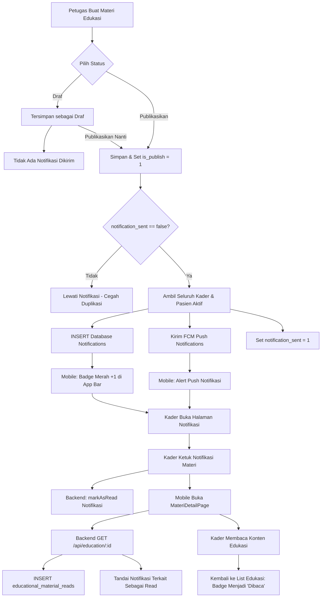

# AUDIT & ARSITEKTUR MODUL EDUKASI DAN NOTIFIKASI
**Aplikasi:** TB Care Mobile (Flutter) & TB Care Backend (Laravel 11)  
**Tanggal Evaluasi:** 7 November 2026  
**Fokus Khusus:** Modul Edukasi Kesehatan, Mekanisme Notifikasi Multi-Channel, & Sinkronisasi Riwayat Pembacaan

---

## 1. PENDAHULUAN

Modul Edukasi dan Sistem Notifikasi merupakan instrumen krusial dalam ekosistem TB Care untuk meningkatkan literasi kesehatan pasien TB dan membekali Kader Kesehatan dengan informasi medis mutakhir (etika batuk, kepatuhan OAT, gizi pendukung, dan penanganan efek samping obat).

Dokumen ini mendokumentasikan hasil audit teknis, pemisahan status notifikasi vs materi, proteksi hak cipta & RBAC, serta arsitektur alur notifikasi terintegrasi.

---

## 2. AUDIT MODUL EDUKASI

### 2.1 Kebijakan Hak Akses & Kewenangan (RBAC)
Sesuai aturan bisnis aplikasi:
- **Pengelolaan Materi (Create, Update, Delete, Upload Media, Draf/Publish):**
  - Hanya diizinkan bagi **Super Admin** (`user_type_id = 1`) dan **Petugas PJTB Puskesmas** (`user_type_id = 3`, `officer_type_id != 4`).
- **Hak Akses Kader:**
  - **Read-Only**: Kader hanya berhak melihat materi edukasi yang telah berstatus dipublikasikan (`is_publish = 1`).
  - Dilarang membuat, mengubah, menghapus, atau melihat materi berstatus draf (`is_publish = 0`).
  - Permintaan HTTP ke endpoint manipulasi atau detail materi draf oleh Kader langsung diblokir oleh backend dengan HTTP 403 Forbidden.
- **Tampilan Mobile:**
  - Tab "Draft" disembunyikan secara otomatis untuk Kader dan Pasien.
  - Floating Action Button (FAB) "+" disembunyikan.
  - Ikon edit dan hapus pada kartu materi disembunyikan.

### 2.2 Penanganan Media & Keamanan Streaming (Bypass Cloudflare WAF)
- **Tantangan Lingkungan:** Permintaan langsung ke direktori `/images/...` atau `/storage/...` melalui HTTP client mobile berpotensi diblokir oleh Web Application Firewall (WAF Cloudflare) dengan kode status 403 Forbidden.
- **Solusi:**
  - Mobile menggunakan helper `Connection.resolveImageUrl(photo)` yang secara otomatis memetakan path lokal maupun URL server menjadi endpoint proxy API:
    `$BASE_URL/image/{filename}`
  - Backend `Api\ImageController@show` membaca file dari storage lokal internal yang aman dan mengalirkannya secara langsung (*direct binary stream*) dengan Content-Type yang valid (`image/jpeg`, `image/png`).
  - Thumbnail video YouTube diekstrak melalui `YoutubeUrlHelper` menggunakan URL resmi YouTube image CDN (`img.youtube.com/vi/{id}/hqdefault.jpg`).

---

## 3. ARSITEKTUR NOTIFIKASI MULTI-CHANNEL

Sistem notifikasi TB Care mengadopsi pendekatan hybrid multi-channel:

```
[Peristiwa Publikasi Materi Baru]
               │
               ▼
   [EducationalMaterial Model]
               │
   sendPublishNotification() (Proteksi Idempotensi)
               │
       ┌───────┴───────┐
       ▼               ▼
[Channel Database]   [Channel FCM Push]
       │               │
       │               ├─► Firebase Cloud Messaging
       │               │   (Ponsel Menerima Push Alert / Heads-up)
       │               │
       ▼               ▼
[Tabel notifications]  [Ponsel Kader / Pasien]
 (read_at = NULL)       (Foreground: Local Notification + Auto Count Refresh)
```

### 3.1 Channel Database (In-App Notification)
- Disimpan pada tabel `notifications` standar Laravel.
- Kolom: `id` (UUID), `type` (`App\Notifications\EducationPublishedNotification`), `notifiable_type`, `notifiable_id`, `data` (JSON payload), `read_at`, `created_at`.
- Berfungsi sebagai arsip riwayat pemberitahuan yang dapat dibuka kembali kapan saja di `NotificationListPage`.

### 3.2 Channel Firebase Cloud Messaging (FCM)
- Mengirimkan pesan push ke perangkat Android pengguna yang terdaftar token FCM-nya.
- Menyertakan payload `data`:
  ```json
  {
    "notification_type": "education_published",
    "type": "education_published",
    "education_id": "101",
    "title": "Materi Edukasi Baru: Etika Batuk Efektif",
    "message": "Petugas kesehatan telah mempublikasikan materi edukasi baru..."
  }
  ```

---

## 4. PEMISAHAN STATUS: NOTIFIKASI DIBACA VS MATERI DIBACA

Salah satu persyaratan kunci arsitektur ini adalah membedakan secara tegas antara:
1. **Status Notifikasi Dibaca (`read_at` pada tabel `notifications`):**
   - Mengindikasikan apakah pemberitahuan tersebut sudah dilihat/diketuk oleh pengguna di Pusat Notifikasi.
2. **Status Materi Edukasi Dibaca (`read_at` pada tabel `educational_material_reads`):**
   - Mengindikasikan apakah konten materi edukasi tersebut sudah pernah dibuka dan dibaca oleh pengguna.

### 4.1 Sinkronisasi Otomatis Terpadu
Untuk memberikan pengalaman pengguna yang seamless:
- Ketika Kader membuka notifikasi edukasi di `NotificationListPage`, notifikasi ditandai sebagai dibaca (`POST /api/notifications/{id}/read`).
- Aplikasi langsung membuka halaman detail materi (`MateriDetailPage`).
- Ketika `MateriDetailPage` memuat data via `GET /api/education/{id}`, controller backend secara otomatis:
  1. Memasukkan record ke tabel `educational_material_reads` untuk user tersebut (`is_read = true`).
  2. Mencari seluruh notifikasi database milik user yang memiliki payload `education_id = $id` dan berstatus belum dibaca, lalu otomatis menandainya sebagai dibaca (`read_at = now()`).
- Di sisi mobile, kartu materi pada `EducationPage` langsung beralih dari label **"Baru"** menjadi **"Dibaca"**, dan angka badge lonceng pada App Bar berkurang.
- Materi tetap tersimpan di daftar edukasi dan dapat dibaca kembali kapan saja tanpa batas.

---

## 5. PENCEGAHAN DUPLIKASI & IDEMPOTENSI NOTIFIKASI

Untuk mencegah pengiriman notifikasi berulang saat Petugas mengedit atau menyimpan ulang materi yang sudah dipublikasikan:
1. **Flag Basis Data `notification_sent`:**
   - Kolom boolean `notification_sent` pada tabel `educational_materials`.
   - Method `sendPublishNotification()` memeriksa:
     ```php
     if ($this->notification_sent || !$this->is_publish) {
         return; // Batalkan, jangan kirim duplikat
     }
     ```
2. **Tabel Riwayat Baca `user_material_read_unique`:**
   - Menggunakan indeks unik majemuk `['user_id', 'educational_material_id']`.
   - Menggunakan `firstOrCreate()` pada backend, sehingga pembacaan berulang kali oleh user yang sama tidak menghasilkan record ganda.

---

## 6. DIAGRAM ALUR PROSES LENGKAP



---

## 7. KESIMPULAN AUDIT

Modul Edukasi dan Sistem Notifikasi telah dirancang dan diimplementasikan dengan kepatuhan penuh terhadap standar medis dan rekayasa perangkat lunak modern:
- **Kader:** Terinformasikan secara instan setiap ada materi baru tanpa hak modifikasi.
- **Petugas:** Memiliki kontrol publikasi penuh tanpa risiko spam notifikasi berulang.
- **Sistem:** Efisien, idempoten, dan tersinkronisasi sempurna antara status baca notifikasi dan status baca materi edukasi.
