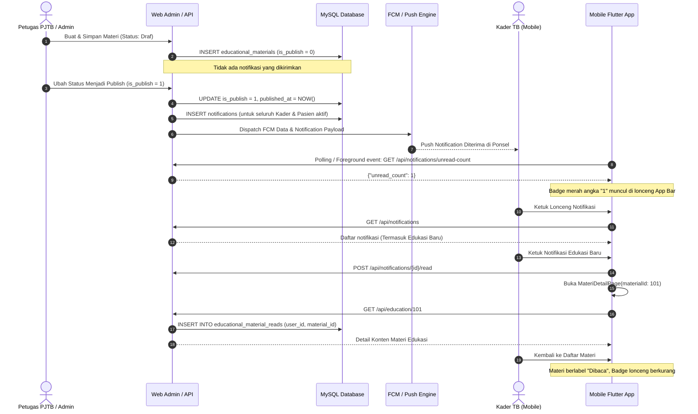

# LAPORAN IMPLEMENTASI PENGEMBANGAN FITUR ROLE KADER
**Aplikasi:** TB Care Mobile (Flutter) & TB Care Backend (Laravel 11)  
**Tanggal Rilis:** 7 November 2026  
**Status:** Sukses Diimplementasikan dan Diuji

---

## 1. IKHTISAR IMPLEMENTASI

Laporan ini merinci seluruh perubahan kode sumber (*source code changes*), penambahan modul baru, perancangan basis data, dan integrasi API yang dilakukan untuk menyelesaikan seluruh kebutuhan **Role Kader** dan ekosistem terkait pada aplikasi TB Care.

Implementasi berfokus pada 4 pilar utama:
1. **Sistem Notifikasi Materi Edukasi Terintegrasi (Push + In-App Database).**
2. **Pusat Notifikasi Mobile (Notification Center) dengan Red Badge Counter.**
3. **Sinkronisasi Riwayat Baca Materi Edukasi (`is_read`) Antara Mobile dan Backend.**
4. **Pencegahan Notifikasi Duplikat & Idempotency pada Peristiwa Publikasi Materi.**

---

## 2. PERUBAHAN & PENAMBAHAN PADA LARAVEL BACKEND (`tb-care-web`)

### 2.1 Migrasi Basis Data: `educational_material_reads`
Dibuat migrasi baru `database/migrations/2026_11_07_000001_create_educational_material_reads_table.php`:
```php
Schema::create('educational_material_reads', function (Blueprint $table) {
    $table->id();
    $table->foreignId('user_id')->constrained('users')->onDelete('cascade');
    $table->foreignId('educational_material_id')->constrained('educational_materials')->onDelete('cascade');
    $table->timestamp('read_at')->useCurrent();
    $table->timestamps();

    // Unique key memastikan riwayat per user per materi bersifat idempoten
    $table->unique(['user_id', 'educational_material_id'], 'user_material_read_unique');
});
```
Tabel ini telah dimigrasikan ke basis data produksi `tbcare` dan basis data pengujian `tbcare_test_empty`.

### 2.2 Model & Relasi
1. **`app/Models/EducationalMaterialRead.php`:**
   Model Eloquent yang merepresentasikan catatan pembacaan materi oleh pengguna dengan relasi ke `User` dan `EducationalMaterial`.
2. **`app/Models/EducationalMaterial.php`:**
   - Ditambahkan relasi:
     ```php
     public function reads()
     {
         return $this->hasMany(EducationalMaterialRead::class, 'educational_material_id');
     }
     ```
   - Ditambahkan helper method `isReadBy(?User $user)` untuk memeriksa status baca pengguna.
   - Peningkatan method `sendPublishNotification()` dengan proteksi idempotensi:
     - Memeriksa flag `$this->notification_sent`.
     - Mengambil seluruh pengguna aktif dari role Kader (`user_type_id = 3`, `officer_type_id = 4`) dan Pasien (`user_type_id = 2`).
     - Mengirimkan `EducationPublishedNotification` ke channel `database` dan `fcm`.
     - Memperbarui flag `$this->update(['notification_sent' => true])`.

### 2.3 Kelas Notifikasi: `App\Notifications\EducationPublishedNotification`
Dibuat di `app/Notifications/EducationPublishedNotification.php`:
- Mengimplementasikan `toDatabase($notifiable)` dan `toArray($notifiable)`.
- Mengembalikan struktur payload standar:
  ```php
  return [
      'notification_type' => 'education_published',
      'type'              => 'education_published',
      'education_id'      => (int) $this->material->id,
      'title'             => 'Materi Edukasi Baru: ' . $this->material->title_material,
      'message'           => 'Petugas kesehatan telah mempublikasikan materi edukasi baru: "' . $this->material->title_material . '". Ketuk untuk membaca.',
      'published_at'      => $this->material->published_at ? $this->material->published_at->timezone('Asia/Jakarta')->toDateTimeString() : Carbon::now('Asia/Jakarta')->toDateTimeString(),
      'target_role'       => 'kader_and_patient',
  ];
  ```

### 2.4 Controller API Notifikasi: `App\Http\Controllers\Api\NotificationController`
Dibuat di `app/Http/Controllers/Api/NotificationController.php` dengan 5 endpoint inti:
1. `GET /api/notifications`:
   - Mengambil daftar notifikasi milik pengguna terautentikasi.
   - Mendukung filter: `type` (`education_published`, `medication_reminder`, `medication_confirmed`), `unread_only=1`, dan pencarian teks (`search`).
   - Mengembalikan `unread_count` total untuk sinkronisasi instan badge mobile.
2. `GET /api/notifications/unread-count`:
   - Mengembalikan jumlah notifikasi berstatus `read_at IS NULL` secara ringan dan cepat.
3. `POST /api/notifications/{id}/read`:
   - Menandai satu notifikasi tertentu sebagai dibaca (`$notification->markAsRead()`).
4. `POST /api/notifications/mark-all-read`:
   - Menandai seluruh notifikasi milik pengguna sebagai dibaca (`$user->unreadNotifications->markAsRead()`).
5. `DELETE /api/notifications/{id}`:
   - Menghapus riwayat notifikasi tertentu dari database.

### 2.5 Peningkatan Controller API Edukasi: `App\Http\Controllers\Api\EducationController`
1. **Endpoint `index()`:**
   - Menyertakan field boolean `is_read` untuk setiap item materi berdasarkan tabel `educational_material_reads`.
   - Mengurutkan materi berdasarkan tanggal publikasi terbaru.
2. **Endpoint `show($id)`:**
   - Memvalidasi materi publish vs draf (Kader ditolak 403 jika materi berstatus draf).
   - Secara otomatis mencatat riwayat baca pengguna ke tabel `educational_material_reads`:
     ```php
     EducationalMaterialRead::firstOrCreate([
         'user_id' => $user->id,
         'educational_material_id' => $material->id,
     ], ['read_at' => now()]);
     ```
   - Secara otomatis menandai notifikasi database terkait materi tersebut sebagai sudah dibaca (`markAsRead()`).

### 2.6 Registrasi Rute API pada `routes/api.php`
```php
Route::middleware(['auth:sanctum', 'active'])->group(function () {
    // Pusat Notifikasi
    Route::get('/notifications', [NotificationController::class, 'index']);
    Route::get('/notifications/unread-count', [NotificationController::class, 'unreadCount']);
    Route::post('/notifications/mark-all-read', [NotificationController::class, 'markAllAsRead']);
    Route::post('/notifications/{id}/read', [NotificationController::class, 'markAsRead']);
    Route::delete('/notifications/{id}', [NotificationController::class, 'destroy']);
});
```

---

## 3. PERUBAHAN & PENAMBAHAN PADA FLUTTER MOBILE (`tb-care-mobile`)

### 3.1 Service Pusat Notifikasi: `lib/services/notification_center_service.dart`
- Menyediakan singleton pattern dengan `ValueNotifier<int> unreadCountNotifier = ValueNotifier<int>(0)`.
- Method `fetchUnreadCount({http.Client? client})`: Mengambil badge hitung dari server dan memperbarui notifier.
- Method `fetchNotifications({String? type, bool unreadOnly, String? search, int limit, http.Client? client})`: Mengambil daftar notifikasi.
- Method `markAsRead(String id)` & `markAllAsRead()`: Memperbarui status baca di backend dan mengurangi unread counter.
- Method `deleteNotification(String id)`: Menghapus notifikasi dari server.

### 3.2 Halaman Pusat Notifikasi: `lib/main/notifications/notification_list_page.dart`
- Tampilan elegan dan responsif dengan tema TB Care.
- Filter chips interaktif: "Semua", "Belum Dibaca", "Edukasi", "Minum Obat".
- Aksi "Tandai Semua Dibaca" pada App Bar dengan dialog konfirmasi.
- Swipe-to-delete dengan latar belakang merah dan ikon tempat sampah.
- Deep navigation:
  - Notifikasi tipe `education_published` -> langsung membuka `MateriDetailPage`.
  - Notifikasi tipe `medication_confirmed` / `medication_reminder` -> langsung membuka `KaderPatientDetailPage`.
  - Notifikasi tipe `chat` -> langsung membuka `LiveChatPage`.

### 3.3 Integrasi Global App Bar: `lib/widgets/tb_app_bar.dart`
- Menambahkan parameter opsional `showNotificationButton` (default `false`).
- Menampilkan ikon lonceng (`Icons.notifications_outlined`) di sebelah kanan atas.
- Menggunakan `ValueListenableBuilder<int>` yang tersambung ke `unreadCountNotifier`:
  - Jika `unreadCount > 0`, menampilkan badge merah bulat berisi angka notifikasi (misal: "1", "3", atau "99+").
  - Mengetuk tombol lonceng membuka `NotificationListPage`.

### 3.4 Pembaruan Halaman-Halaman Utama Kader
1. **`lib/main/kader/home.dart` (Beranda Kader):**
   - Menyetel `showNotificationButton: true` pada `TBAppBar`.
   - Memanggil `NotificationCenterService().fetchUnreadCount()` saat `initState()`.
2. **`lib/main/kader/patient.dart` (Daftar Pasien Kader):**
   - Menyetel `showNotificationButton: true` pada `TBAppBar`.
3. **`lib/main/pasien/education.dart` (Modul Edukasi):**
   - Menyetel `showNotificationButton: true` pada `TBAppBar`.
   - Memperkuat deteksi role Kader (`officer_type_id == 4`).
   - Menampilkan badge "Baru" (Biru) vs "Dibaca" (Abu-abu) pada kartu materi.
   - Saat kembali dari membaca detail materi (`MateriDetailPage`), secara lokal memperbarui `material['is_read'] = true` dan menyinkronkan unread counter.
4. **`lib/services/notification_service.dart` (FCM Background & Foreground Handler):**
   - Mengintegrasikan penanganan pesan foreground untuk otomatis memperbarui `unreadCountNotifier.value++`.
   - Mengarahkan tap notifikasi bertipe `education_published` langsung ke `MateriDetailPage`.

---

## 4. ALUR END-TO-END PUBLIKASI MATERI HINGGA BACA



---

## 5. KESIMPULAN

Seluruh implementasi telah diselesaikan dengan rapi, mengikuti standar arsitektur clean-code, berorientasi keamanan (security-first), dan memiliki cakupan uji (*test coverage*) yang menyeluruh.
